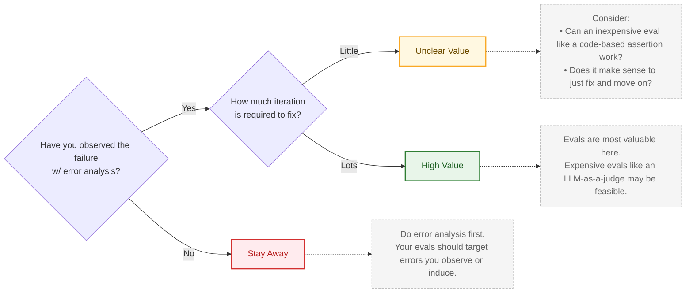
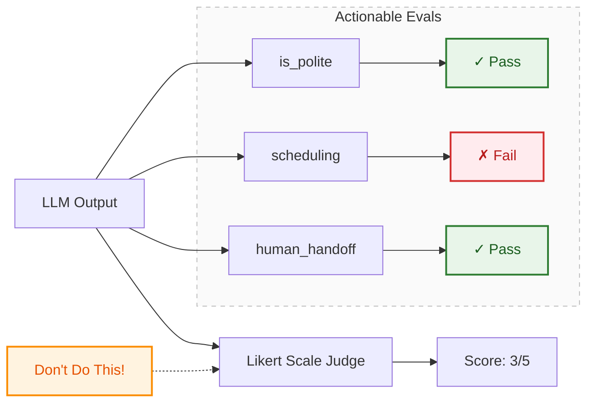
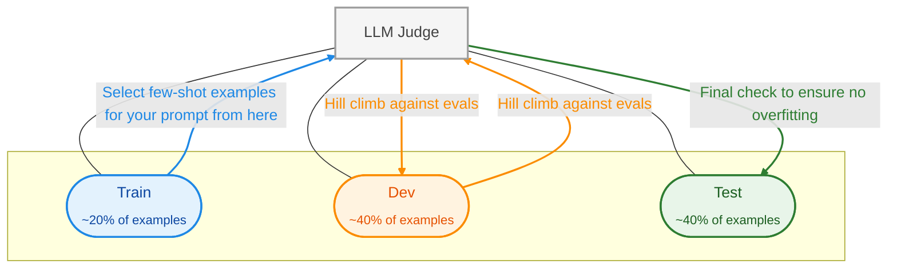

# AI Evals - Consolidated Guide

The workflow, in order:

1. **Look at the data**: error analysis on sampled traces finds the failures that matter.
2. **Decide whether a failure deserves an eval**: only for observed failures that need iteration.
3. **Build test data**: from real traces (n−1 turns) and structured synthetic data.
4. **Pick the cheapest eval that works**: code assertion → LLM-as-judge → guardrail.
5. **Trust judges only after calibration**: binary scores, human labels, TPR/TNR.
6. **Deploy evals in three places**: CI/CD, online monitoring, guardrails.
7. **Re-validate when the system changes**: judges are only valid for the outputs they were calibrated on → [[⭐️⭐️ AI Evals - Re-Validating LLM-Judges After an Architecture Change]]

## 1. Error analysis: find failures first

- error analysis = allows you to quickly find patterns of failures in your AI products' logs & traces
- process
	1. **collect traces** → gather diverse sample of 100+ traces from production or real/synthetic usage of your own
	2. **annotate traces** → review each trace, write brief/unstructured notes on the problem e.g. "hallucination", "misread user name", "failed calculator tool"
		- stop at the first, most upstream error you find in each trace → this keeps things tractable (upstream failures tend to be most important)
	3. **group & categorise** → group similar notes into clusters e.g. "failed tool call", "tone violation"
	4. **prioritise** → count frequency of each category, this informs priority
- tips
	- keep looking at data until you feel like you're not learning anything new
		- aka "*theoretical saturation*"
	- rule of thumb: need ~100 high quality & diverse traces
		- can be using real data, synthetic data
		- needs to have both pass & fail cases
		- and ideally a variety of failure modes

### Ways to sample traces

- you can sample traces either more exploratory or by using signals
	- methods from most exploratory (first) to more signal based (last)
		- random → always do this alongside other strategies to discover unknown issues
		- clustering → group traces according to semantic similarity or clustering algo & see if you discover new errors
		- data analysis → analyse statistics on latency, turns, tool calls, tokens etc for outliers
		- classification → use your existing evals, a predictive model or an LLM to surface problematic traces (use w caution)
		- feedback → use explicit customer feedback to filter traces

### Finding failing steps in agents: transition failure matrices

- for agents with many steps, finding which step it fails the most on can be hard
	- e.g. plan > search > code > finalise etc
	- a ***transition failure matrix*** helps you find hotspots
- how a transition failure matrix works
	1. define states → list all possible steps or states the agent can be in
	2. create a matrix → create a grid where rows are the `FROM` state and columns are the `TO` state
	3. count failures → for each failure, identify last successful transition that occurred before the error & populate count of failures in grid cells accordingly

example of a transition matrix

```markdown
|                 | ParseReq | IntentClass | DecideTool | GenSQL | ExecSQL | PlanCal | ExecCal |
| --------------- | :------: | :---------: | :--------: | :----: | :-----: | :-----: | :-----: |
| **ParseReq**    |    0     |      3      |     0      |   0    |    0    |    0    |    0    |
| **IntentClass** |    0     |      0      |     4      |   0    |    0    |    0    |    0    |
| **DecideTool**  |    0     |      0      |     0      |   6    |    0    |    2    |    0    |
| **GenSQL**      |    0     |      0      |     0      |   0    |   12    |    0    |    0    |
| **ExecSQL**     |    0     |      0      |     0      |   0    |    0    |    5    |    0    |
| **PlanCal**     |    0     |      0      |     0      |   0    |    0    |    0    |    7    |
| **ExecCal**     |    0     |      0      |     0      |   0    |    0    |    0    |    0    |
```

## 2. When to write an eval

- use the following decision tree
	1. have you observed the failure mode with analysis?
		- (no to 1) → do error analysis first, your evals should target errors you observe or induce
	2. (yes to 1) how much iteration is required to fix?
	3. (low effort to 2) unclear value → consider inexpensive eval like deterministic assertion, or just fix and move on
	4. (high effort to 2) high value → evals are most valuable here, e.g. LLM-as-judge
- notes/tips
	- evals provide more value when you need to hill climb against an error
	- you don't always need to write an eval



### What makes a good eval metric

- don't use generic scores:
	- ROUGE, BLEU, Faithfulness, Helpfulness, Tone
	- not tailored to your use-case or data
- instead use application specific metrics (examples below):
	- Calendar scheduling failure
	- Interrupted conversation flow
	- Widget rendering issue
	- Email recipient incorrect
	- Failure to escalate to human
- **good eval metrics**:
	- measure an error you have observed
	- relate to a non-trivial issue you will iterate on
	- are scoped to a specific failure
	- have a binary outcome (not 1-5 score) → see [[#Binary scores, not Likert scales]]
	- are verifiable e.g. human annotation or LLM-as-Judge

## 3. Building test data

### From real traces

1. gather traces related to your top failures (from error analysis)
	- for each of these traces, minimally reproduce the failure in as few turns with as little complexity as possible
2. $n - 1$
	- collect a dataset of minimally reproduced failures and use the $n-1$ turns before the error as test cases
	- this assumes your system isn't changing rapidly
3. additional test coverage
	- can modify the traces from step 2 in valid ways using an LLM
	- e.g. rephrasing, adding variation etc
4. simulated LLM user
	- simulating a user with another LLM → doing this well can be challenging

### Synthetic data to bootstrap evals

- **use structured input for diversity** → define key dimensions (e.g. feature/persona/scenario) & use them as variables in your prompt
- **seed generation w real logs/traces** → then ask LLM to explicitly inject changes like a new constraint or modified variable
	- this helps create realistic edge cases
- **enforce output structure & filter** → define a schema for the output
	- generate many candidates, then filter to retain the highest quality, challenging examples
- **increase complexity iteratively** → start w simple queries & incrementally ask the LLM to add constraints, complex formatting etc
- do not:
	- prompt w zero-shot requests lacking structured input
	- e.g. "generate 50 test cases"
	- these generally give generic, repetitive inputs

## 4. Types of automated evals

1. code based assertions & deterministic tests
	- check for objective or rule-based failures
	- e.g. matching keywords, confirming tool execution etc
	- use them whenever possible → they're cheap, deterministic & interpretable
2. LLM-as-Judge
	- uses an LLM to assess subjective or nuanced criteria that isn't deterministic/code-suitable
	- while powerful, they are slower, more expensive & require verification/alignment (calibration) → see [[#5. LLM judges]]
	- reserve these for more important failures due to their cost
3. guardrails
	- run in the request/response path to block failures before they reach the user
	- tend to be fast + have a low false-positive rate to avoid blocking valid responses
	- commonly implemented as code-based checks, small classifiers or LLMs

## 5. LLM judges

### Binary scores, not Likert scales

- binary (pass & fail) scores are preferable in most cases vs. likert scales (1-5 ratings)
- likert scales are expensive to align w domain experts
	- annotators often default to middle values to avoid making difficult decisions
	- they can also encourage too much scope → e.g. overall quality score vs a targeted eval
- binary scores compel the annotator to make a definitive decision
	- better aligns w reality that you must decide whether or not the feature is good enough to ship for the AI application
	- binary scores are also easier to apply during error analysis



### How to trust an LLM judge

- the ***only*** way to trust an LLM Judge is to measure it against human labels
	- commonly known as aligning or calibrating the judge
	- not doing so creates an untrustworthy and misaligned metric
- split your human labelled data into 3 sets
	- train → where you draw your few shot examples from
	- dev → where you use to optimise your judge
	- test → a final check to ensure you haven't overfit
- don't report accuracy
	- it's misleading on imbalanced data
	- use TPR & TNR → aim for a high TPR & TNR rate e.g. > 90%
		- TPR = of the real errors, what % does the judge flag?
		- TNR = of the outputs that are fine, what % does the judge pass?



## 6. Deploying evals for continuous improvement

| | **CI/CD** | **Online monitoring** | **Guardrails** |
| --- | --- | --- | --- |
| goal | prevent regressions | discover new failures & track performance | enforce safety & block high impact errors |
| when | pre-merge on pull requests | async (post-response) | synchronous (pre-response) |
| how | unit tests, LLM Judges | unit tests, LLM Judges, A/B testing | unit tests, small classifiers, LLM guardrails |
| data | curated test cases | sampled production traffic | 100% of live traffic |
| on failure | block the merge | trigger an alert | block response, retry, fallback or escalate |

- AI evals are most valuable when they find new failures
	- a perfect score on all evals often means they are saturated or too easy
	- add hard test cases to keep guiding improvement

## 7. Re-validating judges after a system change

- a judge's TPR/TNR is only evidence about the outputs it was calibrated on → re-validate judges after big changes (prompt, model, architecture)
- full worked analysis (multi-agent → single-agent banking chatbot): [[⭐️⭐️ AI Evals - Re-Validating LLM-Judges After an Architecture Change]]

## Checklist: common eval mistakes

1. an automated eval is useless if it doesn't measure your specific failures → look at your data first (§1)
2. an LLM judge you haven't measured against human labels is an untrustworthy metric (§5)
3. a perfect score on all evals means they're saturated or too easy → add hard cases (§6)
