# Knowledge Vault GraphRAG — Design Spec

Oct 4, 2026 · @Dom Nasrabadi

## Goals and scope

Build a claim-centred GraphRAG over Dom's Knowledge Vault. It answers questions with cited evidence, weighted by how strongly the vault supports each claim. The graph is a derived index: it can be rebuilt from the vault at any time, and it never edits Dom's notes. Its only writes go to `50 Graph/`.

**Question types it must answer:**

- **Global:** themes across many sources ("what patterns run through everything on agent evaluation?").
- **Local:** which source said X, with the exact passage.
- **Temporal:** how claims on a topic changed over time, and what Dom read when.
- **Connective:** what links two concepts, entities or sources.

**In scope:** notes in `10 Sources/` (Articles, Papers) and `20 Books/`, about 360 notes. This is a rough estimate, not a count; the real number changes as notes are filed. Build phases 0–6 (see Build phases), including the retrieval tools.

**Out of scope for now:** `30 Projects/`, `40 System/`, the separate local personal vault, how Dom invokes the system (MCP server, skill, CLI or UI), and anything that depends on that interface, such as capturing 👍/👎 feedback.

**How to read this spec:** terms in the Glossary have exactly the meaning given there. Every number lives in Config and defaults. Prompt IDs (P1–P14) refer to the LLM prompt inventory.

**Revision 2026-11-15:** a review against the vault's real numbers changed the design in these places: a baseline and the question set come before the graph; co-occurrence is counted within a heading section; decay falls back to `created` when `published` is missing; new Registry entries are auto-approved and the Review Queue is bounded; the Registry is data, not notes; claims are extracted per note and matched by cluster on the first build; w is reduced to quality × decay; simplification trims 1–9 are applied; the phases are renumbered 0–6. Changed passages carry the date. The diagrams under Data schema, Preprocessing, Mention resolution, Counting support, Maintenance and Query answering were relabelled the same day to match; their layouts are unchanged.

## Glossary

| Term | Meaning |
| --- | --- |
| Source | One in-scope note: an article, a paper, a book cover page, or a book chapter. |
| Book | A folder in `20 Books/` that contains at least one type: chapter note. Every note in that folder belongs to the Book. Notes in other book folders (e.g. the 23 separate notes in MindBranches) are standalone sources. |
| Passage | A chunk of one source, at most 400 tokens, counted with the embedding model's tokenizer (tiktoken cl100k\_base until phase 0 picks one). Claims cite passages. |
| Voice | Who wrote a passage's text, set by note status: `highlight` (a `raw` or `structured` note: the source's words, selected by Dom) or `mine` (a `status: distilled` note). `<mark>` tags no longer set voice (decided 2026-11-15). Whether the distilled MindBranches summaries are `mine` is open (see Open questions). |
| Highlight density | Dropped on 2026-11-15. It was the share of a passage's characters inside `<mark>` tags, which is close to 0 for almost every passage in this vault. It is not computed or used. |
| Concept | An idea that many sources can discuss: a method, problem, property or pattern, e.g. LLM-as-a-Judge, context rot, error analysis. It has a definition, not a maker. Test: if it can be defined without naming one product, person or paper, it is a concept. |
| Entity | A named thing: person, organisation, tool or library, model, benchmark or dataset, or paper. One particular thing that someone made or is, e.g. Graphiti, GPT-4, MT-Bench. An entity can be INSTANCE\_OF a concept. |
| Registry | The master list of canonical concepts and entities for the whole vault: one entry each, with its aliases. Every mention in every note resolves to exactly one entry, so the graph counts one thing once whatever it was called. Stored as data in `.graphrag/export/registry.jsonl`, not as notes. |
| Mention | A span of passage text that names a concept or entity. |
| Claim | One self-contained assertion plus its qualifiers: something that could be true or false. Claims and passages are many-to-many: one passage can support several claims, and one claim can be supported or contradicted by passages from many notes. |
| Qualifier | A condition that limits a claim, e.g. "only for pairwise comparisons". |
| Referenced time | The date or period a claim is about, when the text states one. Otherwise, the source's `published` date. |
| Volatility class | `durable`, `evolving` or `ephemeral`. Sets how fast a claim's support decays. |
| Independence group | The unit counted once when adding up support: the Book for notes in a Book folder, otherwise the source note itself. A raw note and its distilled sibling always count as one group. config.yaml can group other notes by hand (e.g. the two notes for Agentic Design Patterns). |
| Support / opposition | A claim's weighted, saturated totals of supporting and contradicting evidence. |
| Saturated | Passed through ln(1 + x), so each extra independence group adds less than the one before. |
| Contested | A claim whose opposition is large relative to its support (thresholds in Config). |
| Superseded | A claim that a newer claim explicitly replaces. It is kept, with `valid_to` set. |
| Orphaned | A claim with no remaining support. It is kept but hidden from retrieval. |
| Concept neighbourhood | All claims that share at least one ABOUT target (concept or entity). |
| NPMI | Normalised pointwise mutual information: how much more often two concepts co-occur than chance predicts, scaled to −1 … 1. |
| Co-occurrence | Two Registry entries co-occur in an independence group when at least one heading section in that group mentions both. Each group counts once. CO\_OCCURS edges weight this by NPMI. |
| Community | A cluster of concepts and entities found by graph clustering, with an LLM-written summary. Formed by Leiden clustering over CO\_OCCURS and typed relation edges: a set of entries joined by many strong edges and few edges outward. |
| RRF | Reciprocal rank fusion: merges ranked lists by summing 1 / (k + rank) for each item. |
| Sync run | One run of the incremental pipeline. One sync run = one review batch. |
| Shadow graph | Replaced on 2026-11-15 (trim 5) by a new store file: a re-extraction builds into a separate file, which replaces the live store only after Dom approves a stats diff. |
| Review Queue | The markdown file where Dom approves or rejects uncertain decisions. |
| MOC | Map of content: an Obsidian hub note. Here, a generated page for a concept or entity supported by 3 or more independence groups (deferred, trim 9). |
| Lineage | Fields on every node and edge recording how, when and by what it was made. |
| add-tag, vault-lint | Existing vault skills in `.claude/skills/`. add-tag gatekeeps the topic taxonomy; vault-lint validates note structure. |

## Source vault facts

The metadata is clean enough to use as weighting signals from day one. Note-to-note links are almost absent, so the graph must be built by extraction. Figures are from the repo as of 2026-09-27.

| Field | Values | What the graph uses it for |
| --- | --- | --- |
| `type` | article 179 · chapter 37 · book 48 · paper 54 | Source node kind; chapters grouped under their Book |
| `quality` | 3: 1 · 2: 43 · 1: 76 · unrated: \~198 | Source weight. Filename stars match `quality` in all but 3 notes |
| `status` | raw 173 · structured 106 · distilled 39 | Voice: text in a distilled note is mine |
| `topics` | \~45 kebab-case tags, closed list gatekept by add-tag | Compared with emergent communities to suggest taxonomy changes. Not an input to clustering (see Communities) |
| `published` | ISO date, often empty for papers and articles | World time: recency decay, temporal queries |
| `created` / `updated` | ISO date | Engagement time: what was read when, revisits |
| `author`, `source` | Often empty (\~half of papers) | Creates author Entity nodes; shown in citations. Not used to merge independence groups |
| `flashcards` | Always `none` today | Not used |

**Body conventions:** numbered headings, deeply nested bullets, occasional `<mark>` highlights, `> [!NOTE]` callouts, code blocks, tables, and screenshot embeds.

**Highlights:** a raw note *is* Dom's highlights, exported as plain bullets, so `<mark>` tags are rare. Checked 2026-10-19: none of 173 raw notes contain `<mark>`; 54 of 106 structured notes and 2 of 40 distilled notes contain any; the average share of marked characters is about 1%. Highlight density is therefore close to 0 almost everywhere (see Open questions).

**Links:** about 1,150 wikilinks, nearly all `![[Screenshot…]]` embeds or same-note heading links. There are effectively no links between notes.

**Checked 2026-11-15:** 326 in-scope notes, about 1M tokens (3.9M characters), so roughly 3,000 passages; the median note is about 1,500 tokens. 157 notes have no `published` date (45 of 48 books, 33 of 37 chapters, 55 of 187 articles, 24 of 54 papers). Of the 40 distilled notes, 22 are MindBranches summaries, 15 are AI Evals articles and 3 sit in book folders; only 2 have a raw sibling in the same folder.

## Graph model

Claims are the core unit. Passages support or contradict claims. Claims are ABOUT concepts and entities. Communities group concepts and entities.

```dot
digraph "graph-model" {
  layout=neato; inputscale=72; notranslate=true; overlap=true; splines=line;
  outputorder=nodesfirst; bgcolor=transparent; pad=0.1;
  node [fontname="Helvetica"]; edge [arrowhead=none];
  t1 [shape=none margin=0 width=8.3889 height=0.3889 fixedsize=true label=<<TABLE BORDER="0" CELLPADDING="0" CELLSPACING="0"><TR><TD FIXEDSIZE="TRUE" WIDTH="600" HEIGHT="24" ALIGN="LEFT"><FONT FACE="Helvetica" POINT-SIZE="15" COLOR="#1f1f1f"><B>Claims sit at the centre; evidence flows up from sources</B></FONT></TD></TR></TABLE>> pos="324.0,579.0!"];
  b2 [shape=box style="rounded,filled" fillcolor="#efeeea" color="#b4b1a5" penwidth=1.25 width=4.4444 height=2.0000 fixedsize=true label="" pos="300.0,384.0!"];
  t3 [shape=none margin=0 width=1.2333 height=0.3444 fixedsize=true label=<<TABLE BORDER="0" CELLPADDING="0" CELLSPACING="0"><TR><TD FIXEDSIZE="TRUE" WIDTH="85" HEIGHT="21" ALIGN="LEFT"><FONT FACE="Helvetica" POINT-SIZE="13" COLOR="#1f1f1f"><B>Registry</B></FONT></TD></TR></TABLE>> pos="198.4,438.3!"];
  t4 [shape=none margin=0 width=1.3467 height=0.3111 fixedsize=true label=<<TABLE BORDER="0" CELLPADDING="0" CELLSPACING="0"><TR><TD FIXEDSIZE="TRUE" WIDTH="93" HEIGHT="18" ALIGN="CENTER"><FONT FACE="Helvetica" POINT-SIZE="11.5" COLOR="#6b6b6b">INSTANCE_OF</FONT></TD></TR></TABLE>> pos="300.0,353.8!"];
  t5 [shape=none margin=0 width=4.8222 height=0.3111 fixedsize=true label=<<TABLE BORDER="0" CELLPADDING="0" CELLSPACING="0"><TR><TD FIXEDSIZE="TRUE" WIDTH="343" HEIGHT="18" ALIGN="CENTER"><FONT FACE="Helvetica" POINT-SIZE="11.5" COLOR="#6b6b6b">Entries link by CO_OCCURS and typed relations</FONT></TD></TR></TABLE>> pos="300.0,329.8!"];
  b6 [shape=box style="rounded" fillcolor="white" color="#b4b1a5" penwidth=1.25 width=3.3333 height=0.7778 fixedsize=true label="" pos="300.0,524.0!"];
  b7 [shape=box style="rounded" fillcolor="white" color="#b4b1a5" penwidth=1.25 width=1.7222 height=0.7778 fixedsize=true label="" pos="218.0,396.0!"];
  b8 [shape=box style="rounded" fillcolor="white" color="#b4b1a5" penwidth=1.25 width=1.7222 height=0.7778 fixedsize=true label="" pos="382.0,396.0!"];
  b9 [shape=box style="rounded,filled" fillcolor="#e5eefb" color="#2f6fd6" penwidth=2 width=3.3333 height=0.7778 fixedsize=true label="" pos="300.0,244.0!"];
  b10 [shape=box style="rounded" fillcolor="white" color="#b4b1a5" penwidth=1.25 width=3.3333 height=0.7778 fixedsize=true label="" pos="300.0,148.0!"];
  b11 [shape=box style="rounded" fillcolor="white" color="#b4b1a5" penwidth=1.25 width=3.3333 height=0.7778 fixedsize=true label="" pos="300.0,52.0!"];
  b12 [shape=box style="rounded" fillcolor="white" color="#b4b1a5" penwidth=1.25 width=2.5000 height=0.7778 fixedsize=true label="" pos="590.0,52.0!"];
  t13 [shape=none margin=0 width=1.3597 height=0.3444 fixedsize=true label=<<TABLE BORDER="0" CELLPADDING="0" CELLSPACING="0"><TR><TD FIXEDSIZE="TRUE" WIDTH="94" HEIGHT="21" ALIGN="CENTER"><FONT FACE="Helvetica" POINT-SIZE="13" COLOR="#1f1f1f"><B>Community</B></FONT></TD></TR></TABLE>> pos="300.0,532.3!"];
  t14 [shape=none margin=0 width=3.3911 height=0.3111 fixedsize=true label=<<TABLE BORDER="0" CELLPADDING="0" CELLSPACING="0"><TR><TD FIXEDSIZE="TRUE" WIDTH="240" HEIGHT="18" ALIGN="CENTER"><FONT FACE="Helvetica" POINT-SIZE="11.5" COLOR="#6b6b6b">LLM-summarised cluster (Leiden)</FONT></TD></TR></TABLE>> pos="300.0,515.8!"];
  t15 [shape=none margin=0 width=0.9806 height=0.3444 fixedsize=true label=<<TABLE BORDER="0" CELLPADDING="0" CELLSPACING="0"><TR><TD FIXEDSIZE="TRUE" WIDTH="67" HEIGHT="21" ALIGN="CENTER"><FONT FACE="Helvetica" POINT-SIZE="13" COLOR="#1f1f1f"><B>Entity</B></FONT></TD></TR></TABLE>> pos="218.0,404.3!"];
  t16 [shape=none margin=0 width=1.3467 height=0.3111 fixedsize=true label=<<TABLE BORDER="0" CELLPADDING="0" CELLSPACING="0"><TR><TD FIXEDSIZE="TRUE" WIDTH="93" HEIGHT="18" ALIGN="CENTER"><FONT FACE="Helvetica" POINT-SIZE="11.5" COLOR="#6b6b6b">named thing</FONT></TD></TR></TABLE>> pos="218.0,387.8!"];
  t17 [shape=none margin=0 width=1.1069 height=0.3444 fixedsize=true label=<<TABLE BORDER="0" CELLPADDING="0" CELLSPACING="0"><TR><TD FIXEDSIZE="TRUE" WIDTH="76" HEIGHT="21" ALIGN="CENTER"><FONT FACE="Helvetica" POINT-SIZE="13" COLOR="#1f1f1f"><B>Concept</B></FONT></TD></TR></TABLE>> pos="382.0,404.3!"];
  t18 [shape=none margin=0 width=1.5511 height=0.3111 fixedsize=true label=<<TABLE BORDER="0" CELLPADDING="0" CELLSPACING="0"><TR><TD FIXEDSIZE="TRUE" WIDTH="108" HEIGHT="18" ALIGN="CENTER"><FONT FACE="Helvetica" POINT-SIZE="11.5" COLOR="#6b6b6b">abstract idea</FONT></TD></TR></TABLE>> pos="382.0,387.8!"];
  t19 [shape=none margin=0 width=0.8542 height=0.3444 fixedsize=true label=<<TABLE BORDER="0" CELLPADDING="0" CELLSPACING="0"><TR><TD FIXEDSIZE="TRUE" WIDTH="58" HEIGHT="21" ALIGN="CENTER"><FONT FACE="Helvetica" POINT-SIZE="13" COLOR="#1f1f1f"><B>Claim</B></FONT></TD></TR></TABLE>> pos="300.0,252.3!"];
  t20 [shape=none margin=0 width=3.2889 height=0.3111 fixedsize=true label=<<TABLE BORDER="0" CELLPADDING="0" CELLSPACING="0"><TR><TD FIXEDSIZE="TRUE" WIDTH="233" HEIGHT="18" ALIGN="CENTER"><FONT FACE="Helvetica" POINT-SIZE="11.5" COLOR="#1f1f1f">one assertion + its qualifiers</FONT></TD></TR></TABLE>> pos="300.0,235.8!"];
  t21 [shape=none margin=0 width=1.1069 height=0.3444 fixedsize=true label=<<TABLE BORDER="0" CELLPADDING="0" CELLSPACING="0"><TR><TD FIXEDSIZE="TRUE" WIDTH="76" HEIGHT="21" ALIGN="CENTER"><FONT FACE="Helvetica" POINT-SIZE="13" COLOR="#1f1f1f"><B>Passage</B></FONT></TD></TR></TABLE>> pos="300.0,156.3!"];
  t22 [shape=none margin=0 width=3.0844 height=0.3111 fixedsize=true label=<<TABLE BORDER="0" CELLPADDING="0" CELLSPACING="0"><TR><TD FIXEDSIZE="TRUE" WIDTH="218" HEIGHT="18" ALIGN="CENTER"><FONT FACE="Helvetica" POINT-SIZE="11.5" COLOR="#6b6b6b">up to 400 tokens, with voice</FONT></TD></TR></TABLE>> pos="300.0,139.8!"];
  t23 [shape=none margin=0 width=0.9806 height=0.3444 fixedsize=true label=<<TABLE BORDER="0" CELLPADDING="0" CELLSPACING="0"><TR><TD FIXEDSIZE="TRUE" WIDTH="67" HEIGHT="21" ALIGN="CENTER"><FONT FACE="Helvetica" POINT-SIZE="13" COLOR="#1f1f1f"><B>Source</B></FONT></TD></TR></TABLE>> pos="300.0,60.3!"];
  t24 [shape=none margin=0 width=3.2889 height=0.3111 fixedsize=true label=<<TABLE BORDER="0" CELLPADDING="0" CELLSPACING="0"><TR><TD FIXEDSIZE="TRUE" WIDTH="233" HEIGHT="18" ALIGN="CENTER"><FONT FACE="Helvetica" POINT-SIZE="11.5" COLOR="#6b6b6b">article, paper or chapter note</FONT></TD></TR></TABLE>> pos="300.0,43.8!"];
  t25 [shape=none margin=0 width=0.7278 height=0.3444 fixedsize=true label=<<TABLE BORDER="0" CELLPADDING="0" CELLSPACING="0"><TR><TD FIXEDSIZE="TRUE" WIDTH="48" HEIGHT="21" ALIGN="CENTER"><FONT FACE="Helvetica" POINT-SIZE="13" COLOR="#1f1f1f"><B>Book</B></FONT></TD></TR></TABLE>> pos="590.0,60.3!"];
  t26 [shape=none margin=0 width=2.5733 height=0.3111 fixedsize=true label=<<TABLE BORDER="0" CELLPADDING="0" CELLSPACING="0"><TR><TD FIXEDSIZE="TRUE" WIDTH="181" HEIGHT="18" ALIGN="CENTER"><FONT FACE="Helvetica" POINT-SIZE="11.5" COLOR="#6b6b6b">folder of chapter notes</FONT></TD></TR></TABLE>> pos="590.0,43.8!"];
  p27 [shape=point width=0.001 height=0.001 style=invis pos="300.0,496.0!"];
  p28 [shape=point width=0.001 height=0.001 style=invis pos="300.0,456.0!"];
  p29 [shape=point width=0.001 height=0.001 style=invis pos="300.0,272.0!"];
  p30 [shape=point width=0.001 height=0.001 style=invis pos="300.0,312.0!"];
  p31 [shape=point width=0.001 height=0.001 style=invis pos="300.0,176.0!"];
  p32 [shape=point width=0.001 height=0.001 style=invis pos="300.0,216.0!"];
  p33 [shape=point width=0.001 height=0.001 style=invis pos="300.0,80.0!"];
  p34 [shape=point width=0.001 height=0.001 style=invis pos="300.0,120.0!"];
  p35 [shape=point width=0.001 height=0.001 style=invis pos="420.0,52.0!"];
  p36 [shape=point width=0.001 height=0.001 style=invis pos="500.0,52.0!"];
  p37 [shape=point width=0.001 height=0.001 style=invis pos="280.0,382.0!"];
  p38 [shape=point width=0.001 height=0.001 style=invis pos="320.0,382.0!"];
  p39 [shape=point width=0.001 height=0.001 style=invis pos="420.0,256.0!"];
  p40 [shape=point width=0.001 height=0.001 style=invis pos="448.0,256.0!"];
  p41 [shape=point width=0.001 height=0.001 style=invis pos="448.0,232.0!"];
  p42 [shape=point width=0.001 height=0.001 style=invis pos="420.0,232.0!"];
  p43 [shape=point width=0.001 height=0.001 style=invis pos="180.0,148.0!"];
  p44 [shape=point width=0.001 height=0.001 style=invis pos="120.0,148.0!"];
  p45 [shape=point width=0.001 height=0.001 style=invis pos="120.0,364.0!"];
  p46 [shape=point width=0.001 height=0.001 style=invis pos="140.0,364.0!"];
  p47 [shape=point width=0.001 height=0.001 style=invis pos="180.0,38.0!"];
  p48 [shape=point width=0.001 height=0.001 style=invis pos="92.0,38.0!"];
  p49 [shape=point width=0.001 height=0.001 style=invis pos="92.0,404.0!"];
  p50 [shape=point width=0.001 height=0.001 style=invis pos="156.0,404.0!"];
  t51 [shape=none margin=0 width=1.0400 height=0.3111 fixedsize=true label=<<TABLE BORDER="0" CELLPADDING="0" CELLSPACING="0"><TR><TD FIXEDSIZE="TRUE" WIDTH="71" HEIGHT="18" ALIGN="LEFT"><FONT FACE="Helvetica" POINT-SIZE="11.5" COLOR="#6b6b6b">CONTAINS</FONT></TD></TR></TABLE>> pos="347.4,475.8!"];
  t52 [shape=none margin=0 width=0.7333 height=0.3111 fixedsize=true label=<<TABLE BORDER="0" CELLPADDING="0" CELLSPACING="0"><TR><TD FIXEDSIZE="TRUE" WIDTH="49" HEIGHT="18" ALIGN="LEFT"><FONT FACE="Helvetica" POINT-SIZE="11.5" COLOR="#6b6b6b">ABOUT</FONT></TD></TR></TABLE>> pos="336.4,291.8!"];
  t53 [shape=none margin=0 width=4.5156 height=0.3111 fixedsize=true label=<<TABLE BORDER="0" CELLPADDING="0" CELLSPACING="0"><TR><TD FIXEDSIZE="TRUE" WIDTH="321" HEIGHT="18" ALIGN="LEFT"><FONT FACE="Helvetica" POINT-SIZE="11.5" COLOR="#6b6b6b">SUPPORTS · QUALIFIED_SUPPORT · CONTRADICTS</FONT></TD></TR></TABLE>> pos="472.6,195.8!"];
  t54 [shape=none margin=0 width=1.3467 height=0.3111 fixedsize=true label=<<TABLE BORDER="0" CELLPADDING="0" CELLSPACING="0"><TR><TD FIXEDSIZE="TRUE" WIDTH="93" HEIGHT="18" ALIGN="LEFT"><FONT FACE="Helvetica" POINT-SIZE="11.5" COLOR="#6b6b6b">HAS_PASSAGE</FONT></TD></TR></TABLE>> pos="358.5,99.8!"];
  t55 [shape=none margin=0 width=0.9378 height=0.3111 fixedsize=true label=<<TABLE BORDER="0" CELLPADDING="0" CELLSPACING="0"><TR><TD FIXEDSIZE="TRUE" WIDTH="64" HEIGHT="18" ALIGN="CENTER"><FONT FACE="Helvetica" POINT-SIZE="11.5" COLOR="#6b6b6b">IN_BOOK</FONT></TD></TR></TABLE>> pos="460.0,63.8!"];
  t56 [shape=none margin=0 width=2.2667 height=0.3111 fixedsize=true label=<<TABLE BORDER="0" CELLPADDING="0" CELLSPACING="0"><TR><TD FIXEDSIZE="TRUE" WIDTH="159" HEIGHT="18" ALIGN="LEFT"><FONT FACE="Helvetica" POINT-SIZE="11.5" COLOR="#6b6b6b">REFINES · SUPERSEDES</FONT></TD></TR></TABLE>> pos="535.6,243.8!"];
  t57 [shape=none margin=0 width=1.0400 height=0.3111 fixedsize=true label=<<TABLE BORDER="0" CELLPADDING="0" CELLSPACING="0"><TR><TD FIXEDSIZE="TRUE" WIDTH="71" HEIGHT="18" ALIGN="LEFT"><FONT FACE="Helvetica" POINT-SIZE="11.5" COLOR="#6b6b6b">MENTIONS</FONT></TD></TR></TABLE>> pos="161.4,187.8!"];
  t58 [shape=none margin=0 width=1.2222 height=0.3111 fixedsize=true label=<<TABLE BORDER="0" CELLPADDING="0" CELLSPACING="0"><TR><TD FIXEDSIZE="TRUE" WIDTH="84" HEIGHT="18" ALIGN="RIGHT"><FONT FACE="Helvetica" POINT-SIZE="11.5" COLOR="#6b6b6b">AUTHORED_BY</FONT></TD></TR></TABLE>> pos="44.0,207.8!"];
  p59 [shape=point width=0.001 height=0.001 style=invis pos="0.0,604.0!"];
  p60 [shape=point width=0.001 height=0.001 style=invis pos="760.0,0.0!"];
  p27 -> p28 [dir=forward arrowhead=normal arrowsize=0.55 color="#b4b1a5" penwidth=1.25];
  p29 -> p30 [dir=forward arrowhead=normal arrowsize=0.55 color="#b4b1a5" penwidth=1.25];
  p31 -> p32 [dir=forward arrowhead=normal arrowsize=0.55 color="#b4b1a5" penwidth=1.25];
  p33 -> p34 [dir=forward arrowhead=normal arrowsize=0.55 color="#b4b1a5" penwidth=1.25];
  p35 -> p36 [dir=forward arrowhead=normal arrowsize=0.55 color="#b4b1a5" penwidth=1.25];
  p37 -> p38 [dir=forward arrowhead=normal arrowsize=0.55 color="#b4b1a5" penwidth=1.25];
  p39 -> p40 [dir=none color="#b4b1a5" penwidth=1.25];
  p40 -> p41 [dir=none color="#b4b1a5" penwidth=1.25];
  p41 -> p42 [dir=forward arrowhead=normal arrowsize=0.55 color="#b4b1a5" penwidth=1.25];
  p43 -> p44 [dir=none color="#b4b1a5" penwidth=1.25];
  p44 -> p45 [dir=none color="#b4b1a5" penwidth=1.25];
  p45 -> p46 [dir=forward arrowhead=normal arrowsize=0.55 color="#b4b1a5" penwidth=1.25];
  p47 -> p48 [dir=none color="#b4b1a5" penwidth=1.25];
  p48 -> p49 [dir=none color="#b4b1a5" penwidth=1.25];
  p49 -> p50 [dir=forward arrowhead=normal arrowsize=0.55 color="#b4b1a5" penwidth=1.25];
}
```



Evidence flows upward: Source → Passage → Claim → Concept or Entity → Community. Fields for each node type are in Data schema.

| Edge | From → To | Meaning | Created by |
| --- | --- | --- | --- |
| HAS\_PASSAGE | Source → Passage | The passage is part of the source | Parser |
| IN\_BOOK | Source → Book | The chapter belongs to the book | Parser |
| MENTIONS | Passage → Concept or Entity | The passage names it | P1 + P2 |
| SUPPORTS | Passage → Claim | The passage asserts the claim | P3 + P4 |
| QUALIFIED\_SUPPORT | Passage → Claim | The passage asserts the claim only under a stated condition | P4 |
| CONTRADICTS | Passage → Claim | The passage asserts the opposite | P4 |
| ABOUT | Claim → Concept or Entity | The claim's subject | P3 |
| REFINES | Claim → Claim | A narrower or qualified version of another claim | P4 |
| SUPERSEDES | Claim → Claim | A newer claim that explicitly replaces an older one | P4 |
| INSTANCE\_OF | Entity → Concept | The entity is an example of the concept | P2 |
| CO\_OCCURS | Concept/Entity ↔ Concept/Entity | NPMI-weighted association (undirected) | Scoring job |
| Typed relation | Concept/Entity → Concept/Entity | An approved relation type, e.g. MITIGATES or ALTERNATIVE\_TO | P5 + Dom's approval |
| CONTAINS | Community → Concept or Entity | Community membership | Clustering |
| AUTHORED\_BY | Source → Entity (person) | The person wrote the source | Parser + P2, from frontmatter author |

**Entities and concepts are never merged.** An entity is linked to the concept it exemplifies by INSTANCE\_OF. For example, Graphiti INSTANCE\_OF temporal graph memory. Both are Registry entries.

**Claims and passages are many-to-many.** A passage can support several claims, and a claim gathers passages from many notes. Support grows as more independent notes back the same claim.

**Relation types are discovered, not designed up front (deferred 2026-11-15, trim 3).** P3 still stores relation phrases, but phrase clustering, P5 and typed relation edges are not built yet. The design, kept for later: For each pair of ABOUT targets, P3 also outputs a short relation phrase ("reduces", "is an alternative to"), stored on the claim. Once 200 new phrases have built up (or monthly), phrases are embedded and clustered. A cluster with at least 5 phrases from at least 3 independence groups is named by P5 and proposed in the Review Queue. Once approved, it becomes a typed relation edge. Until then, concepts are linked only by CO\_OCCURS.

**Hierarchy comes from communities.** No broader/narrower edges are curated. Nesting comes from community levels.

**Embeddings are used alongside the graph:**

- **Passages:** entry points for retrieval and for local fact lookups.
- **Registry names and aliases:** candidate generation for mention resolution (P2).
- **Claims:** candidate generation for claim matching (P4), and a retrieval entry point.
- **Community summaries:** choosing which communities answer a global question.

**Generated content is never evidence.** Community summaries and MOC pages are generated from source content. They can steer retrieval, but they never count as support and are never cited as a source.

## Data schema

Every node and edge has a stable `id` and the lineage fields below. IDs never change once assigned, so edits, renames and re-runs don't break references.

```dot
digraph "data-schema" {
  layout=neato; inputscale=72; notranslate=true; overlap=true; splines=line;
  outputorder=nodesfirst; bgcolor=transparent; pad=0.1;
  node [fontname="Helvetica"]; edge [arrowhead=none];
  t1 [shape=none margin=0 width=7.3681 height=0.3889 fixedsize=true label=<<TABLE BORDER="0" CELLPADDING="0" CELLSPACING="0"><TR><TD FIXEDSIZE="TRUE" WIDTH="526" HEIGHT="24" ALIGN="LEFT"><FONT FACE="Helvetica" POINT-SIZE="15" COLOR="#1f1f1f"><B>Six node types, each with a stable ID and lineage</B></FONT></TD></TR></TABLE>> pos="287.2,470.9!"];
  b2 [shape=box style="rounded" fillcolor="white" color="#b4b1a5" penwidth=1.25 width=3.2222 height=1.9444 fixedsize=true label="" pos="136.0,370.0!"];
  t3 [shape=none margin=0 width=0.9806 height=0.3444 fixedsize=true label=<<TABLE BORDER="0" CELLPADDING="0" CELLSPACING="0"><TR><TD FIXEDSIZE="TRUE" WIDTH="67" HEIGHT="21" ALIGN="LEFT"><FONT FACE="Helvetica" POINT-SIZE="13" COLOR="#1f1f1f"><B>Source</B></FONT></TD></TR></TABLE>> pos="65.3,420.3!"];
  t4 [shape=none margin=0 width=3.5956 height=0.3111 fixedsize=true label=<<TABLE BORDER="0" CELLPADDING="0" CELLSPACING="0"><TR><TD FIXEDSIZE="TRUE" WIDTH="255" HEIGHT="18" ALIGN="LEFT"><FONT FACE="Helvetica" POINT-SIZE="11.5" COLOR="#6b6b6b">src: + note path (kept on rename)</FONT></TD></TR></TABLE>> pos="159.4,401.8!"];
  t5 [shape=none margin=0 width=2.9822 height=0.3111 fixedsize=true label=<<TABLE BORDER="0" CELLPADDING="0" CELLSPACING="0"><TR><TD FIXEDSIZE="TRUE" WIDTH="211" HEIGHT="18" ALIGN="LEFT"><FONT FACE="Helvetica" POINT-SIZE="11.5" COLOR="#1f1f1f">path, type, status, quality</FONT></TD></TR></TABLE>> pos="137.4,381.8!"];
  t6 [shape=none margin=0 width=3.0844 height=0.3111 fixedsize=true label=<<TABLE BORDER="0" CELLPADDING="0" CELLSPACING="0"><TR><TD FIXEDSIZE="TRUE" WIDTH="218" HEIGHT="18" ALIGN="LEFT"><FONT FACE="Helvetica" POINT-SIZE="11.5" COLOR="#1f1f1f">topics, author, URL, book_id</FONT></TD></TR></TABLE>> pos="141.0,365.8!"];
  t7 [shape=none margin=0 width=2.9822 height=0.3111 fixedsize=true label=<<TABLE BORDER="0" CELLPADDING="0" CELLSPACING="0"><TR><TD FIXEDSIZE="TRUE" WIDTH="211" HEIGHT="18" ALIGN="LEFT"><FONT FACE="Helvetica" POINT-SIZE="11.5" COLOR="#1f1f1f">published, created, updated</FONT></TD></TR></TABLE>> pos="137.4,349.8!"];
  b8 [shape=box style="rounded" fillcolor="white" color="#b4b1a5" penwidth=1.25 width=3.2222 height=1.9444 fixedsize=true label="" pos="380.0,370.0!"];
  t9 [shape=none margin=0 width=0.7278 height=0.3444 fixedsize=true label=<<TABLE BORDER="0" CELLPADDING="0" CELLSPACING="0"><TR><TD FIXEDSIZE="TRUE" WIDTH="48" HEIGHT="21" ALIGN="LEFT"><FONT FACE="Helvetica" POINT-SIZE="13" COLOR="#1f1f1f"><B>Book</B></FONT></TD></TR></TABLE>> pos="300.2,420.3!"];
  t10 [shape=none margin=0 width=2.1644 height=0.3111 fixedsize=true label=<<TABLE BORDER="0" CELLPADDING="0" CELLSPACING="0"><TR><TD FIXEDSIZE="TRUE" WIDTH="152" HEIGHT="18" ALIGN="LEFT"><FONT FACE="Helvetica" POINT-SIZE="11.5" COLOR="#6b6b6b">book: + folder path</FONT></TD></TR></TABLE>> pos="351.9,401.8!"];
  t11 [shape=none margin=0 width=2.0622 height=0.3111 fixedsize=true label=<<TABLE BORDER="0" CELLPADDING="0" CELLSPACING="0"><TR><TD FIXEDSIZE="TRUE" WIDTH="144" HEIGHT="18" ALIGN="LEFT"><FONT FACE="Helvetica" POINT-SIZE="11.5" COLOR="#1f1f1f">folder path, title</FONT></TD></TR></TABLE>> pos="348.2,381.8!"];
  t12 [shape=none margin=0 width=1.9600 height=0.3111 fixedsize=true label=<<TABLE BORDER="0" CELLPADDING="0" CELLSPACING="0"><TR><TD FIXEDSIZE="TRUE" WIDTH="137" HEIGHT="18" ALIGN="LEFT"><FONT FACE="Helvetica" POINT-SIZE="11.5" COLOR="#1f1f1f">author, published</FONT></TD></TR></TABLE>> pos="344.6,365.8!"];
  b13 [shape=box style="rounded" fillcolor="white" color="#b4b1a5" penwidth=1.25 width=3.2222 height=1.9444 fixedsize=true label="" pos="624.0,370.0!"];
  t14 [shape=none margin=0 width=1.1069 height=0.3444 fixedsize=true label=<<TABLE BORDER="0" CELLPADDING="0" CELLSPACING="0"><TR><TD FIXEDSIZE="TRUE" WIDTH="76" HEIGHT="21" ALIGN="LEFT"><FONT FACE="Helvetica" POINT-SIZE="13" COLOR="#1f1f1f"><B>Passage</B></FONT></TD></TR></TABLE>> pos="557.9,420.3!"];
  t15 [shape=none margin=0 width=3.0844 height=0.3111 fixedsize=true label=<<TABLE BORDER="0" CELLPADDING="0" CELLSPACING="0"><TR><TD FIXEDSIZE="TRUE" WIDTH="218" HEIGHT="18" ALIGN="LEFT"><FONT FACE="Helvetica" POINT-SIZE="11.5" COLOR="#6b6b6b">psg: + hash(source, text, n)</FONT></TD></TR></TABLE>> pos="629.0,401.8!"];
  t16 [shape=none margin=0 width=3.2889 height=0.3111 fixedsize=true label=<<TABLE BORDER="0" CELLPADDING="0" CELLSPACING="0"><TR><TD FIXEDSIZE="TRUE" WIDTH="233" HEIGHT="18" ALIGN="LEFT"><FONT FACE="Helvetica" POINT-SIZE="11.5" COLOR="#1f1f1f">source_id, breadcrumb, ordinal</FONT></TD></TR></TABLE>> pos="636.4,381.8!"];
  t17 [shape=none margin=0 width=3.0844 height=0.3111 fixedsize=true label=<<TABLE BORDER="0" CELLPADDING="0" CELLSPACING="0"><TR><TD FIXEDSIZE="TRUE" WIDTH="218" HEIGHT="18" ALIGN="LEFT"><FONT FACE="Helvetica" POINT-SIZE="11.5" COLOR="#1f1f1f">text, text_hash, token_count</FONT></TD></TR></TABLE>> pos="629.0,365.8!"];
  t18 [shape=none margin=0 width=2.6756 height=0.3111 fixedsize=true label=<<TABLE BORDER="0" CELLPADDING="0" CELLSPACING="0"><TR><TD FIXEDSIZE="TRUE" WIDTH="189" HEIGHT="18" ALIGN="LEFT"><FONT FACE="Helvetica" POINT-SIZE="11.5" COLOR="#1f1f1f">voice</FONT></TD></TR></TABLE>> pos="614.3,349.8!"];
  t19 [shape=none margin=0 width=1.1422 height=0.3111 fixedsize=true label=<<TABLE BORDER="0" CELLPADDING="0" CELLSPACING="0"><TR><TD FIXEDSIZE="TRUE" WIDTH="78" HEIGHT="18" ALIGN="LEFT"><FONT FACE="Helvetica" POINT-SIZE="11.5" COLOR="#1f1f1f">embedding</FONT></TD></TR></TABLE>> pos="559.1,333.8!"];
  b20 [shape=box style="rounded" fillcolor="white" color="#b4b1a5" penwidth=1.25 width=3.2222 height=1.9444 fixedsize=true label="" pos="136.0,214.0!"];
  t21 [shape=none margin=0 width=2.2444 height=0.3444 fixedsize=true label=<<TABLE BORDER="0" CELLPADDING="0" CELLSPACING="0"><TR><TD FIXEDSIZE="TRUE" WIDTH="158" HEIGHT="21" ALIGN="LEFT"><FONT FACE="Helvetica" POINT-SIZE="13" COLOR="#1f1f1f"><B>Concept / Entity</B></FONT></TD></TR></TABLE>> pos="110.8,264.3!"];
  t22 [shape=none margin=0 width=3.3911 height=0.3111 fixedsize=true label=<<TABLE BORDER="0" CELLPADDING="0" CELLSPACING="0"><TR><TD FIXEDSIZE="TRUE" WIDTH="240" HEIGHT="18" ALIGN="LEFT"><FONT FACE="Helvetica" POINT-SIZE="11.5" COLOR="#6b6b6b">reg:kind:slug (merges redirect)</FONT></TD></TR></TABLE>> pos="152.1,245.8!"];
  t23 [shape=none margin=0 width=2.5733 height=0.3111 fixedsize=true label=<<TABLE BORDER="0" CELLPADDING="0" CELLSPACING="0"><TR><TD FIXEDSIZE="TRUE" WIDTH="181" HEIGHT="18" ALIGN="LEFT"><FONT FACE="Helvetica" POINT-SIZE="11.5" COLOR="#1f1f1f">canonical_name, aliases</FONT></TD></TR></TABLE>> pos="122.6,225.8!"];
  t24 [shape=none margin=0 width=3.1867 height=0.3111 fixedsize=true label=<<TABLE BORDER="0" CELLPADDING="0" CELLSPACING="0"><TR><TD FIXEDSIZE="TRUE" WIDTH="225" HEIGHT="18" ALIGN="LEFT"><FONT FACE="Helvetica" POINT-SIZE="11.5" COLOR="#1f1f1f">definition, kind, entity_type</FONT></TD></TR></TABLE>> pos="144.7,209.8!"];
  t25 [shape=none margin=0 width=2.8800 height=0.3111 fixedsize=true label=<<TABLE BORDER="0" CELLPADDING="0" CELLSPACING="0"><TR><TD FIXEDSIZE="TRUE" WIDTH="203" HEIGHT="18" ALIGN="LEFT"><FONT FACE="Helvetica" POINT-SIZE="11.5" COLOR="#1f1f1f">status: approved, pending,</FONT></TD></TR></TABLE>> pos="133.7,193.8!"];
  t26 [shape=none margin=0 width=2.2667 height=0.3111 fixedsize=true label=<<TABLE BORDER="0" CELLPADDING="0" CELLSPACING="0"><TR><TD FIXEDSIZE="TRUE" WIDTH="159" HEIGHT="18" ALIGN="LEFT"><FONT FACE="Helvetica" POINT-SIZE="11.5" COLOR="#1f1f1f">rejected · embedding</FONT></TD></TR></TABLE>> pos="111.6,177.8!"];
  b27 [shape=box style="rounded,filled" fillcolor="#e5eefb" color="#2f6fd6" penwidth=2 width=3.2222 height=1.9444 fixedsize=true label="" pos="380.0,214.0!"];
  t28 [shape=none margin=0 width=0.8542 height=0.3444 fixedsize=true label=<<TABLE BORDER="0" CELLPADDING="0" CELLSPACING="0"><TR><TD FIXEDSIZE="TRUE" WIDTH="58" HEIGHT="21" ALIGN="LEFT"><FONT FACE="Helvetica" POINT-SIZE="13" COLOR="#1f1f1f"><B>Claim</B></FONT></TD></TR></TABLE>> pos="304.8,264.3!"];
  t29 [shape=none margin=0 width=3.1867 height=0.3111 fixedsize=true label=<<TABLE BORDER="0" CELLPADDING="0" CELLSPACING="0"><TR><TD FIXEDSIZE="TRUE" WIDTH="225" HEIGHT="18" ALIGN="LEFT"><FONT FACE="Helvetica" POINT-SIZE="11.5" COLOR="#1f1f1f">clm: + UUID (merges redirect)</FONT></TD></TR></TABLE>> pos="388.7,245.8!"];
  t30 [shape=none margin=0 width=1.8578 height=0.3111 fixedsize=true label=<<TABLE BORDER="0" CELLPADDING="0" CELLSPACING="0"><TR><TD FIXEDSIZE="TRUE" WIDTH="130" HEIGHT="18" ALIGN="LEFT"><FONT FACE="Helvetica" POINT-SIZE="11.5" COLOR="#1f1f1f">text, qualifiers</FONT></TD></TR></TABLE>> pos="340.9,225.8!"];
  t31 [shape=none margin=0 width=2.9822 height=0.3111 fixedsize=true label=<<TABLE BORDER="0" CELLPADDING="0" CELLSPACING="0"><TR><TD FIXEDSIZE="TRUE" WIDTH="211" HEIGHT="18" ALIGN="LEFT"><FONT FACE="Helvetica" POINT-SIZE="11.5" COLOR="#1f1f1f">relation_phrases, embedding</FONT></TD></TR></TABLE>> pos="381.4,209.8!"];
  t32 [shape=none margin=0 width=2.9822 height=0.3111 fixedsize=true label=<<TABLE BORDER="0" CELLPADDING="0" CELLSPACING="0"><TR><TD FIXEDSIZE="TRUE" WIDTH="211" HEIGHT="18" ALIGN="LEFT"><FONT FACE="Helvetica" POINT-SIZE="11.5" COLOR="#1f1f1f">referenced_time, volatility</FONT></TD></TR></TABLE>> pos="381.4,193.8!"];
  t33 [shape=none margin=0 width=1.8578 height=0.3111 fixedsize=true label=<<TABLE BORDER="0" CELLPADDING="0" CELLSPACING="0"><TR><TD FIXEDSIZE="TRUE" WIDTH="130" HEIGHT="18" ALIGN="LEFT"><FONT FACE="Helvetica" POINT-SIZE="11.5" COLOR="#1f1f1f">status, valid_to</FONT></TD></TR></TABLE>> pos="340.9,177.8!"];
  t34 [shape=none margin=0 width=3.2889 height=0.3111 fixedsize=true label=<<TABLE BORDER="0" CELLPADDING="0" CELLSPACING="0"><TR><TD FIXEDSIZE="TRUE" WIDTH="233" HEIGHT="18" ALIGN="LEFT"><FONT FACE="Helvetica" POINT-SIZE="11.5" COLOR="#1f1f1f">support, opposition, contested</FONT></TD></TR></TABLE>> pos="392.4,161.8!"];
  b35 [shape=box style="rounded" fillcolor="white" color="#b4b1a5" penwidth=1.25 width=3.2222 height=1.9444 fixedsize=true label="" pos="624.0,214.0!"];
  t36 [shape=none margin=0 width=1.3597 height=0.3444 fixedsize=true label=<<TABLE BORDER="0" CELLPADDING="0" CELLSPACING="0"><TR><TD FIXEDSIZE="TRUE" WIDTH="94" HEIGHT="21" ALIGN="LEFT"><FONT FACE="Helvetica" POINT-SIZE="13" COLOR="#1f1f1f"><B>Community</B></FONT></TD></TR></TABLE>> pos="567.0,264.3!"];
  t37 [shape=none margin=0 width=1.3467 height=0.3111 fixedsize=true label=<<TABLE BORDER="0" CELLPADDING="0" CELLSPACING="0"><TR><TD FIXEDSIZE="TRUE" WIDTH="93" HEIGHT="18" ALIGN="LEFT"><FONT FACE="Helvetica" POINT-SIZE="11.5" COLOR="#6b6b6b">com: + UUID</FONT></TD></TR></TABLE>> pos="566.5,245.8!"];
  t38 [shape=none margin=0 width=1.9600 height=0.3111 fixedsize=true label=<<TABLE BORDER="0" CELLPADDING="0" CELLSPACING="0"><TR><TD FIXEDSIZE="TRUE" WIDTH="137" HEIGHT="18" ALIGN="LEFT"><FONT FACE="Helvetica" POINT-SIZE="11.5" COLOR="#1f1f1f">level, member IDs</FONT></TD></TR></TABLE>> pos="588.6,225.8!"];
  t39 [shape=none margin=0 width=2.8800 height=0.3111 fixedsize=true label=<<TABLE BORDER="0" CELLPADDING="0" CELLSPACING="0"><TR><TD FIXEDSIZE="TRUE" WIDTH="203" HEIGHT="18" ALIGN="LEFT"><FONT FACE="Helvetica" POINT-SIZE="11.5" COLOR="#1f1f1f">summary, summary_embedding</FONT></TD></TR></TABLE>> pos="621.7,209.8!"];
  t40 [shape=none margin=0 width=1.9600 height=0.3111 fixedsize=true label=<<TABLE BORDER="0" CELLPADDING="0" CELLSPACING="0"><TR><TD FIXEDSIZE="TRUE" WIDTH="137" HEIGHT="18" ALIGN="LEFT"><FONT FACE="Helvetica" POINT-SIZE="11.5" COLOR="#1f1f1f">built_from, stale</FONT></TD></TR></TABLE>> pos="588.6,193.8!"];
  b41 [shape=box style="rounded,filled" fillcolor="#efeeea" color="#b4b1a5" penwidth=1.25 width=10.0000 height=1.3889 fixedsize=true label="" pos="380.0,70.0!"];
  t42 [shape=none margin=0 width=4.0139 height=0.3444 fixedsize=true label=<<TABLE BORDER="0" CELLPADDING="0" CELLSPACING="0"><TR><TD FIXEDSIZE="TRUE" WIDTH="285" HEIGHT="21" ALIGN="LEFT"><FONT FACE="Helvetica" POINT-SIZE="13" COLOR="#1f1f1f"><B>Lineage on every node and edge</B></FONT></TD></TR></TABLE>> pos="178.5,100.3!"];
  t43 [shape=none margin=0 width=9.0133 height=0.3111 fixedsize=true label=<<TABLE BORDER="0" CELLPADDING="0" CELLSPACING="0"><TR><TD FIXEDSIZE="TRUE" WIDTH="645" HEIGHT="18" ALIGN="LEFT"><FONT FACE="Helvetica" POINT-SIZE="11.5" COLOR="#1f1f1f">run_id (run: source_commit · processed_at · model · prompt) · review_state · decided_by</FONT></TD></TR></TABLE>> pos="358.5,77.8!"];
  t44 [shape=none margin=0 width=10.0833 height=0.3111 fixedsize=true label=<<TABLE BORDER="0" CELLPADDING="0" CELLSPACING="0"><TR><TD FIXEDSIZE="TRUE" WIDTH="722" HEIGHT="18" ALIGN="LEFT"><FONT FACE="Helvetica" POINT-SIZE="11.5" COLOR="#6b6b6b">Source and Book need only source_commit and processed_at. Edges carry from, to, type, confidence.</FONT></TD></TR></TABLE>> pos="397.0,57.8!"];
  t45 [shape=none margin=0 width=7.9911 height=0.3111 fixedsize=true label=<<TABLE BORDER="0" CELLPADDING="0" CELLSPACING="0"><TR><TD FIXEDSIZE="TRUE" WIDTH="571" HEIGHT="18" ALIGN="LEFT"><FONT FACE="Helvetica" POINT-SIZE="11.5" COLOR="#6b6b6b">Passage → Claim edges add the weight w, its factors, and any qualifier text.</FONT></TD></TR></TABLE>> pos="321.7,39.8!"];
  p46 [shape=point width=0.001 height=0.001 style=invis pos="0.0,496.0!"];
  p47 [shape=point width=0.001 height=0.001 style=invis pos="760.0,0.0!"];
}
```



| Node | Key fields | ID rule |
| --- | --- | --- |
| Source | path, type, status, quality, topics, source URL, published, created, updated, author, book\_id | `src:` + note path when first seen. Kept on rename (git rename detection) |
| Book | folder path, title, author, published | `book:` + folder path |
| Passage | source\_id, heading breadcrumb, ordinal, text, text\_hash, token\_count, voice, embedding | `psg:` + hash of (source\_id, text\_hash, n), where n counts earlier passages in the same source with identical text. Edits elsewhere in the note don't change it |
| Concept / Entity | canonical\_name, aliases, definition, kind (`concept` or `entity`), entity\_type (person, org, tool, model, dataset, paper), status (`approved`, `pending`, `rejected`), embedding | `reg:` + kind + slug of the canonical name at creation, e.g. reg:concept:llm-as-a-judge. Renames keep the ID. On a merge, the absorbed entry's ID becomes a redirect to the survivor, its aliases move across, and its Registry record becomes a redirect |
| Claim | text, qualifiers, referenced\_time (start, end), volatility, status (`active`, `superseded`, `orphaned`), valid\_to, relation\_phrases, support, opposition, contested, embedding | `clm:` + UUID. On a merge, the surviving claim keeps its ID and the other ID is stored as a redirect |
| Community | level, member IDs, summary, summary\_embedding, built\_from, stale | `com:` + UUID |

Edges store `from`, `to`, `type` and `confidence`. Passage → Claim edges also store the passage weight w and its factors (see Reinforcement scoring), plus the qualifier text for QUALIFIED\_SUPPORT.

**Lineage fields (every node and edge):**

| Field | Meaning |
| --- | --- |
| `source_commit` | Vault commit the input was read from |
| `processed_at` | When it was created or last changed |
| `model` | Model ID used, if any |
| `prompt` | Prompt ID and version, e.g. `P3@v2`, if any |
| `review_state` | `auto`, provisional (awaiting review), `human_reviewed` or `manually_edited` |
| `decided_by` | Which rule or threshold decided it, or `Dom` |

Source and Book nodes need only `source_commit` and `processed_at`.

**Storage (2026-11-15, trim 8):** `source_commit`, `processed_at`, `model` and `prompt` are stored once per run in a `runs` table, and each record carries a `run_id`. `review_state` and `decided_by` stay on the record.

## Preprocessing

Each source becomes passages of at most 400 tokens that follow the note's own structure. Claims are extracted note by note and cite passages (see Claim extraction and matching).

```dot
digraph "preprocessing" {
  layout=neato; inputscale=72; notranslate=true; overlap=true; splines=line;
  outputorder=nodesfirst; bgcolor=transparent; pad=0.1;
  node [fontname="Helvetica"]; edge [arrowhead=none];
  t1 [shape=none margin=0 width=8.3889 height=0.3889 fixedsize=true label=<<TABLE BORDER="0" CELLPADDING="0" CELLSPACING="0"><TR><TD FIXEDSIZE="TRUE" WIDTH="600" HEIGHT="24" ALIGN="LEFT"><FONT FACE="Helvetica" POINT-SIZE="15" COLOR="#1f1f1f"><B>Each note becomes passages that follow its own structure</B></FONT></TD></TR></TABLE>> pos="324.0,494.9!"];
  p2 [shape=point width=0.001 height=0.001 style=invis pos="208.0,400.0!"];
  p3 [shape=point width=0.001 height=0.001 style=invis pos="736.0,400.0!"];
  p4 [shape=point width=0.001 height=0.001 style=invis pos="208.0,292.0!"];
  p5 [shape=point width=0.001 height=0.001 style=invis pos="736.0,292.0!"];
  p6 [shape=point width=0.001 height=0.001 style=invis pos="208.0,200.0!"];
  p7 [shape=point width=0.001 height=0.001 style=invis pos="736.0,200.0!"];
  p8 [shape=point width=0.001 height=0.001 style=invis pos="208.0,120.0!"];
  p9 [shape=point width=0.001 height=0.001 style=invis pos="736.0,120.0!"];
  b10 [shape=box style="rounded" fillcolor="white" color="#b4b1a5" penwidth=1.25 width=2.0833 height=0.6667 fixedsize=true label="" pos="111.0,440.0!"];
  b11 [shape=box style="rounded" fillcolor="white" color="#b4b1a5" penwidth=1.25 width=2.0833 height=0.6667 fixedsize=true label="" pos="111.0,360.0!"];
  b12 [shape=box style="rounded" fillcolor="white" color="#b4b1a5" penwidth=1.25 width=2.0833 height=0.6667 fixedsize=true label="" pos="111.0,252.0!"];
  b13 [shape=box style="rounded" fillcolor="white" color="#b4b1a5" penwidth=1.25 width=2.0833 height=0.6667 fixedsize=true label="" pos="111.0,160.0!"];
  b14 [shape=box style="rounded" fillcolor="white" color="#b4b1a5" penwidth=1.25 width=2.0833 height=0.6667 fixedsize=true label="" pos="111.0,80.0!"];
  b15 [shape=box style="rounded" fillcolor="white" color="#b4b1a5" penwidth=1 width=1.3333 height=0.3889 fixedsize=true label="" pos="256.0,360.0!"];
  b16 [shape=box style="rounded" fillcolor="white" color="#b4b1a5" penwidth=1 width=1.8056 height=0.3889 fixedsize=true label="" pos="393.0,360.0!"];
  b17 [shape=box style="rounded" fillcolor="white" color="#b4b1a5" penwidth=1 width=1.5556 height=0.3889 fixedsize=true label="" pos="538.0,360.0!"];
  b18 [shape=box style="rounded" fillcolor="white" color="#b4b1a5" penwidth=1 width=1.3333 height=0.3889 fixedsize=true label="" pos="666.0,360.0!"];
  b19 [shape=box style="rounded" fillcolor="white" color="#b4b1a5" penwidth=1 width=3.5556 height=0.3889 fixedsize=true label="" pos="336.0,266.0!"];
  b20 [shape=box style="rounded" fillcolor="white" color="#b4b1a5" penwidth=1 width=3.5556 height=0.3889 fixedsize=true label="" pos="600.0,266.0!"];
  b21 [shape=box style="rounded" fillcolor="white" color="#b4b1a5" penwidth=1 width=3.5556 height=0.3889 fixedsize=true label="" pos="336.0,230.0!"];
  b22 [shape=box style="rounded" fillcolor="white" color="#b4b1a5" penwidth=1 width=3.5556 height=0.3889 fixedsize=true label="" pos="600.0,230.0!"];
  p23 [shape=point width=0.001 height=0.001 style=invis pos="111.0,416.0!"];
  p24 [shape=point width=0.001 height=0.001 style=invis pos="111.0,384.0!"];
  p25 [shape=point width=0.001 height=0.001 style=invis pos="111.0,336.0!"];
  p26 [shape=point width=0.001 height=0.001 style=invis pos="111.0,276.0!"];
  p27 [shape=point width=0.001 height=0.001 style=invis pos="111.0,228.0!"];
  p28 [shape=point width=0.001 height=0.001 style=invis pos="111.0,184.0!"];
  p29 [shape=point width=0.001 height=0.001 style=invis pos="111.0,136.0!"];
  p30 [shape=point width=0.001 height=0.001 style=invis pos="111.0,104.0!"];
  p31 [shape=point width=0.001 height=0.001 style=invis pos="304.0,360.0!"];
  p32 [shape=point width=0.001 height=0.001 style=invis pos="328.0,360.0!"];
  p33 [shape=point width=0.001 height=0.001 style=invis pos="458.0,360.0!"];
  p34 [shape=point width=0.001 height=0.001 style=invis pos="482.0,360.0!"];
  p35 [shape=point width=0.001 height=0.001 style=invis pos="594.0,360.0!"];
  p36 [shape=point width=0.001 height=0.001 style=invis pos="618.0,360.0!"];
  t37 [shape=none margin=0 width=1.2333 height=0.3444 fixedsize=true label=<<TABLE BORDER="0" CELLPADDING="0" CELLSPACING="0"><TR><TD FIXEDSIZE="TRUE" WIDTH="85" HEIGHT="21" ALIGN="CENTER"><FONT FACE="Helvetica" POINT-SIZE="13" COLOR="#1f1f1f"><B>1  Parse</B></FONT></TD></TR></TABLE>> pos="111.0,440.3!"];
  t38 [shape=none margin=0 width=7.6944 height=0.3111 fixedsize=true label=<<TABLE BORDER="0" CELLPADDING="0" CELLSPACING="0"><TR><TD FIXEDSIZE="TRUE" WIDTH="550" HEIGHT="18" ALIGN="LEFT"><FONT FACE="Helvetica" POINT-SIZE="11.5" COLOR="#1f1f1f">Read the frontmatter. Skip excluded paths. Strip Readwise image URLs and HTML wrappers.</FONT></TD></TR></TABLE>> pos="483.0,439.8!"];
  t39 [shape=none margin=0 width=1.2333 height=0.3444 fixedsize=true label=<<TABLE BORDER="0" CELLPADDING="0" CELLSPACING="0"><TR><TD FIXEDSIZE="TRUE" WIDTH="85" HEIGHT="21" ALIGN="CENTER"><FONT FACE="Helvetica" POINT-SIZE="13" COLOR="#1f1f1f"><B>2  Chunk</B></FONT></TD></TR></TABLE>> pos="111.0,360.3!"];
  t40 [shape=none margin=0 width=1.0400 height=0.3111 fixedsize=true label=<<TABLE BORDER="0" CELLPADDING="0" CELLSPACING="0"><TR><TD FIXEDSIZE="TRUE" WIDTH="71" HEIGHT="18" ALIGN="CENTER"><FONT FACE="Helvetica" POINT-SIZE="11.5" COLOR="#1f1f1f">Headings</FONT></TD></TR></TABLE>> pos="256.0,359.8!"];
  t41 [shape=none margin=0 width=1.9600 height=0.3111 fixedsize=true label=<<TABLE BORDER="0" CELLPADDING="0" CELLSPACING="0"><TR><TD FIXEDSIZE="TRUE" WIDTH="137" HEIGHT="18" ALIGN="CENTER"><FONT FACE="Helvetica" POINT-SIZE="11.5" COLOR="#1f1f1f">Top-level bullets</FONT></TD></TR></TABLE>> pos="393.0,359.8!"];
  t42 [shape=none margin=0 width=1.5511 height=0.3111 fixedsize=true label=<<TABLE BORDER="0" CELLPADDING="0" CELLSPACING="0"><TR><TD FIXEDSIZE="TRUE" WIDTH="108" HEIGHT="18" ALIGN="CENTER"><FONT FACE="Helvetica" POINT-SIZE="11.5" COLOR="#1f1f1f">Child bullets</FONT></TD></TR></TABLE>> pos="538.0,359.8!"];
  t43 [shape=none margin=0 width=1.1422 height=0.3111 fixedsize=true label=<<TABLE BORDER="0" CELLPADDING="0" CELLSPACING="0"><TR><TD FIXEDSIZE="TRUE" WIDTH="78" HEIGHT="18" ALIGN="CENTER"><FONT FACE="Helvetica" POINT-SIZE="11.5" COLOR="#1f1f1f">Sentences</FONT></TD></TR></TABLE>> pos="666.0,359.8!"];
  t44 [shape=none margin=0 width=7.6944 height=0.3111 fixedsize=true label=<<TABLE BORDER="0" CELLPADDING="0" CELLSPACING="0"><TR><TD FIXEDSIZE="TRUE" WIDTH="550" HEIGHT="18" ALIGN="LEFT"><FONT FACE="Helvetica" POINT-SIZE="11.5" COLOR="#6b6b6b">Go a level deeper only while a piece exceeds 400 tokens; bullets keep their children.</FONT></TD></TR></TABLE>> pos="483.0,325.8!"];
  t45 [shape=none margin=0 width=7.6944 height=0.3111 fixedsize=true label=<<TABLE BORDER="0" CELLPADDING="0" CELLSPACING="0"><TR><TD FIXEDSIZE="TRUE" WIDTH="550" HEIGHT="18" ALIGN="LEFT"><FONT FACE="Helvetica" POINT-SIZE="11.5" COLOR="#6b6b6b">Never split a code block or table; an oversized one becomes its own passage.</FONT></TD></TR></TABLE>> pos="483.0,309.8!"];
  t46 [shape=none margin=0 width=1.6125 height=0.3444 fixedsize=true label=<<TABLE BORDER="0" CELLPADDING="0" CELLSPACING="0"><TR><TD FIXEDSIZE="TRUE" WIDTH="112" HEIGHT="21" ALIGN="CENTER"><FONT FACE="Helvetica" POINT-SIZE="13" COLOR="#1f1f1f"><B>3  Annotate</B></FONT></TD></TR></TABLE>> pos="111.0,252.3!"];
  t47 [shape=none margin=0 width=2.0622 height=0.3111 fixedsize=true label=<<TABLE BORDER="0" CELLPADDING="0" CELLSPACING="0"><TR><TD FIXEDSIZE="TRUE" WIDTH="144" HEIGHT="18" ALIGN="CENTER"><FONT FACE="Helvetica" POINT-SIZE="11.5" COLOR="#1f1f1f">Heading breadcrumb</FONT></TD></TR></TABLE>> pos="336.0,265.8!"];
  t48 [shape=none margin=0 width=2.5733 height=0.3111 fixedsize=true label=<<TABLE BORDER="0" CELLPADDING="0" CELLSPACING="0"><TR><TD FIXEDSIZE="TRUE" WIDTH="181" HEIGHT="18" ALIGN="CENTER"><FONT FACE="Helvetica" POINT-SIZE="11.5" COLOR="#1f1f1f">Ordinal and token count</FONT></TD></TR></TABLE>> pos="600.0,265.8!"];
  t49 [shape=none margin=0 width=3.4933 height=0.3111 fixedsize=true label=<<TABLE BORDER="0" CELLPADDING="0" CELLSPACING="0"><TR><TD FIXEDSIZE="TRUE" WIDTH="248" HEIGHT="18" ALIGN="CENTER"><FONT FACE="Helvetica" POINT-SIZE="11.5" COLOR="#1f1f1f">Voice: highlight or mine</FONT></TD></TR></TABLE>> pos="336.0,229.8!"];
  t50 [shape=none margin=0 width=3.6978 height=0.3111 fixedsize=true label=<<TABLE BORDER="0" CELLPADDING="0" CELLSPACING="0"><TR><TD FIXEDSIZE="TRUE" WIDTH="262" HEIGHT="18" ALIGN="CENTER"><FONT FACE="Helvetica" POINT-SIZE="11.5" COLOR="#1f1f1f">Set by note status, not &lt;mark&gt;</FONT></TD></TR></TABLE>> pos="600.0,229.8!"];
  t51 [shape=none margin=0 width=1.2333 height=0.3444 fixedsize=true label=<<TABLE BORDER="0" CELLPADDING="0" CELLSPACING="0"><TR><TD FIXEDSIZE="TRUE" WIDTH="85" HEIGHT="21" ALIGN="CENTER"><FONT FACE="Helvetica" POINT-SIZE="13" COLOR="#1f1f1f"><B>4  Embed</B></FONT></TD></TR></TABLE>> pos="111.0,160.3!"];
  t52 [shape=none margin=0 width=7.5822 height=0.3111 fixedsize=true label=<<TABLE BORDER="0" CELLPADDING="0" CELLSPACING="0"><TR><TD FIXEDSIZE="TRUE" WIDTH="542" HEIGHT="18" ALIGN="LEFT"><FONT FACE="Helvetica" POINT-SIZE="11.5" COLOR="#1f1f1f">One vector per passage (tokenizer: cl100k_base until phase 0 picks one).</FONT></TD></TR></TABLE>> pos="479.0,159.8!"];
  t53 [shape=none margin=0 width=2.3708 height=0.3444 fixedsize=true label=<<TABLE BORDER="0" CELLPADDING="0" CELLSPACING="0"><TR><TD FIXEDSIZE="TRUE" WIDTH="167" HEIGHT="21" ALIGN="CENTER"><FONT FACE="Helvetica" POINT-SIZE="13" COLOR="#1f1f1f"><B>5  Books, authors</B></FONT></TD></TR></TABLE>> pos="111.0,80.3!"];
  t54 [shape=none margin=0 width=6.0489 height=0.3111 fixedsize=true label=<<TABLE BORDER="0" CELLPADDING="0" CELLSPACING="0"><TR><TD FIXEDSIZE="TRUE" WIDTH="432" HEIGHT="18" ALIGN="LEFT"><FONT FACE="Helvetica" POINT-SIZE="11.5" COLOR="#1f1f1f">Notes in a Book folder get an IN_BOOK edge to their Book.</FONT></TD></TR></TABLE>> pos="423.8,87.8!"];
  t55 [shape=none margin=0 width=7.3778 height=0.3111 fixedsize=true label=<<TABLE BORDER="0" CELLPADDING="0" CELLSPACING="0"><TR><TD FIXEDSIZE="TRUE" WIDTH="527" HEIGHT="18" ALIGN="LEFT"><FONT FACE="Helvetica" POINT-SIZE="11.5" COLOR="#1f1f1f">Each frontmatter author becomes a person Entity (AUTHORED_BY, via P2).</FONT></TD></TR></TABLE>> pos="471.6,71.8!"];
  t56 [shape=none margin=0 width=9.9333 height=0.3111 fixedsize=true label=<<TABLE BORDER="0" CELLPADDING="0" CELLSPACING="0"><TR><TD FIXEDSIZE="TRUE" WIDTH="711" HEIGHT="18" ALIGN="LEFT"><FONT FACE="Helvetica" POINT-SIZE="11.5" COLOR="#6b6b6b">Boilerplate, code, tables and inline commentary are handled by the extraction prompt, not here.</FONT></TD></TR></TABLE>> pos="391.6,23.8!"];
  p57 [shape=point width=0.001 height=0.001 style=invis pos="0.0,520.0!"];
  p58 [shape=point width=0.001 height=0.001 style=invis pos="760.0,0.0!"];
  p2 -> p3 [dir=none color="#e3e1da" penwidth=1];
  p4 -> p5 [dir=none color="#e3e1da" penwidth=1];
  p6 -> p7 [dir=none color="#e3e1da" penwidth=1];
  p8 -> p9 [dir=none color="#e3e1da" penwidth=1];
  p23 -> p24 [dir=forward arrowhead=normal arrowsize=0.55 color="#b4b1a5" penwidth=1.25];
  p25 -> p26 [dir=forward arrowhead=normal arrowsize=0.55 color="#b4b1a5" penwidth=1.25];
  p27 -> p28 [dir=forward arrowhead=normal arrowsize=0.55 color="#b4b1a5" penwidth=1.25];
  p29 -> p30 [dir=forward arrowhead=normal arrowsize=0.55 color="#b4b1a5" penwidth=1.25];
  p31 -> p32 [dir=forward arrowhead=normal arrowsize=0.55 color="#b4b1a5" penwidth=1.25];
  p33 -> p34 [dir=forward arrowhead=normal arrowsize=0.55 color="#b4b1a5" penwidth=1.25];
  p35 -> p36 [dir=forward arrowhead=normal arrowsize=0.55 color="#b4b1a5" penwidth=1.25];
}
```



1. **Parse:** read the frontmatter. Strip Readwise image URLs and HTML wrappers, but keep `<mark>` tags.
2. **Chunk:** split on headings. If a section is over 400 tokens, split it on its top-level bullets, keeping each bullet with its children. If one bullet with its children is still over 400 tokens, split on its child bullets, then on sentences. Never split inside a code block or table. A code block or table that is over the cap on its own becomes its own passage.
3. **Annotate each passage:**
   - heading breadcrumb (e.g. Agentic GraphRAG › 3. Graph-Based Knowledge Modeling › Entity Resolution)
   - ordinal (its position in the note) and token count
   - **voice**, by note status: `highlight` in a `raw` or `structured` note, `mine` in a `status: distilled` note. `<mark>` tags stay in the text but no longer set voice (decided 2026-11-15).
4. **Embed and index** each passage: one vector for semantic search, and an entry in the BM25 keyword index for exact-word search. Annotation, embedding and indexing happen straight after chunking, as one step.
5. **Books:** every note in a Book folder (see Glossary) gets an IN\_BOOK edge to its Book. Notes in other book folders are standalone sources. Every source's frontmatter author is resolved to a person Entity (via P2) and linked with AUTHORED\_BY.
6. **Exclusions:** `config.yaml` holds an exclude list of in-scope paths that are not source material, e.g. `20 Books/Powerful Python/Flashcard questions.md`. Excluded notes are not parsed.

**Handled by the extraction prompt, not by preprocessing:**

- Boilerplate such as Readwise metadata blocks and heading-link tables of contents. P1 and P3 are told to skip it. Revisit this if the hub audit finds boilerplate turning into hubs, because embeddings and co-occurrence counts don't go through the prompt.
- Code blocks, tables and image embeds stay in the passage text as context. P3 is told not to extract claims from them.
- Dom's inline commentary in raw notes is treated as the source's text (voice `highlight`). It is not tagged `mine`.

## Resolution and claim matching

Every mention is resolved to a Registry entry (a concept or an entity). Every new claim is matched against existing claims. Confident decisions apply automatically, and uncertain ones go to the Review Queue.

All resolution and matching runs at build time. At question time, the only resolution is the `resolve_entity` tool mapping names in the question onto the Registry. The purpose of mention resolution is deduplication: "LLM evaluators" and "LLM-as-a-Judge" become one node, which is what makes counting support and co-occurrence possible.

### Mention resolution

For each mention found by P1:

1. **Exact match:** if the normalised text (lowercase; every run of spaces and punctuation other than + and # becomes one space) equals a canonical name or alias, link to it with confidence 1.0.
2. **Candidates:** otherwise, embed the mention with its passage context and take the 5 most similar Registry entries.
3. **Adjudicate (P2):** the LLM returns `match` (with the target), `new` or `unsure`, plus a confidence. It also decides concept or entity and, for an entity, proposes an INSTANCE\_OF concept.
4. **Apply:**
   - `match` at confidence 0.85 or above: link automatically, logged as reversible.
   - `match` between 0.60 and 0.85, or `unsure`: link provisionally and add a Review Queue item.
   - `new`, or below 0.60: create the entry as `approved` with review\_state `auto`. No Review Queue item is added; duplicates are caught by the clustering pass below (changed 2026-11-15).

```dot
digraph "mention-resolution" {
  layout=neato; inputscale=72; notranslate=true; overlap=true; splines=line;
  outputorder=nodesfirst; bgcolor=transparent; pad=0.1;
  node [fontname="Helvetica"]; edge [arrowhead=none];
  t1 [shape=none margin=0 width=8.8264 height=0.3889 fixedsize=true label=<<TABLE BORDER="0" CELLPADDING="0" CELLSPACING="0"><TR><TD FIXEDSIZE="TRUE" WIDTH="632" HEIGHT="24" ALIGN="LEFT"><FONT FACE="Helvetica" POINT-SIZE="15" COLOR="#1f1f1f"><B>Confident matches link automatically; the rest go to review</B></FONT></TD></TR></TABLE>> pos="339.8,274.9!"];
  b2 [shape=box style="rounded" fillcolor="white" color="#b4b1a5" penwidth=1.25 width=1.1667 height=0.7778 fixedsize=true label="" pos="62.0,164.0!"];
  b3 [shape=diamond style="solid" fillcolor="white" color="#b4b1a5" penwidth=1.25 width=1.5556 height=1.1111 fixedsize=true label="" pos="184.0,164.0!"];
  b4 [shape=box style="rounded,filled" fillcolor="#e5eefb" color="#2f6fd6" penwidth=2 width=1.7778 height=0.6111 fixedsize=true label="" pos="184.0,70.0!"];
  b5 [shape=box style="rounded" fillcolor="white" color="#b4b1a5" penwidth=1.25 width=2.0000 height=0.7778 fixedsize=true label="" pos="336.0,164.0!"];
  b6 [shape=box style="rounded" fillcolor="white" color="#b4b1a5" penwidth=1.25 width=1.4444 height=0.7778 fixedsize=true label="" pos="484.0,164.0!"];
  b7 [shape=box style="rounded" fillcolor="white" color="#b4b1a5" penwidth=1.25 width=2.4444 height=0.6667 fixedsize=true label="" pos="648.0,220.0!"];
  b8 [shape=box style="rounded" fillcolor="white" color="#b4b1a5" penwidth=1.25 width=2.4444 height=0.6667 fixedsize=true label="" pos="648.0,164.0!"];
  b9 [shape=box style="rounded" fillcolor="white" color="#b4b1a5" penwidth=1.25 width=2.4444 height=0.6667 fixedsize=true label="" pos="648.0,108.0!"];
  p10 [shape=point width=0.001 height=0.001 style=invis pos="104.0,164.0!"];
  p11 [shape=point width=0.001 height=0.001 style=invis pos="128.0,164.0!"];
  p12 [shape=point width=0.001 height=0.001 style=invis pos="240.0,164.0!"];
  p13 [shape=point width=0.001 height=0.001 style=invis pos="264.0,164.0!"];
  p14 [shape=point width=0.001 height=0.001 style=invis pos="408.0,164.0!"];
  p15 [shape=point width=0.001 height=0.001 style=invis pos="432.0,164.0!"];
  p16 [shape=point width=0.001 height=0.001 style=invis pos="536.0,164.0!"];
  p17 [shape=point width=0.001 height=0.001 style=invis pos="548.0,164.0!"];
  p18 [shape=point width=0.001 height=0.001 style=invis pos="548.0,220.0!"];
  p19 [shape=point width=0.001 height=0.001 style=invis pos="560.0,220.0!"];
  p20 [shape=point width=0.001 height=0.001 style=invis pos="548.0,164.0!"];
  p21 [shape=point width=0.001 height=0.001 style=invis pos="560.0,164.0!"];
  p22 [shape=point width=0.001 height=0.001 style=invis pos="548.0,164.0!"];
  p23 [shape=point width=0.001 height=0.001 style=invis pos="548.0,108.0!"];
  p24 [shape=point width=0.001 height=0.001 style=invis pos="560.0,108.0!"];
  p25 [shape=point width=0.001 height=0.001 style=invis pos="184.0,124.0!"];
  p26 [shape=point width=0.001 height=0.001 style=invis pos="184.0,92.0!"];
  t27 [shape=none margin=0 width=1.1069 height=0.3444 fixedsize=true label=<<TABLE BORDER="0" CELLPADDING="0" CELLSPACING="0"><TR><TD FIXEDSIZE="TRUE" WIDTH="76" HEIGHT="21" ALIGN="CENTER"><FONT FACE="Helvetica" POINT-SIZE="13" COLOR="#1f1f1f"><B>Mention</B></FONT></TD></TR></TABLE>> pos="62.0,172.3!"];
  t28 [shape=none margin=0 width=0.9378 height=0.3111 fixedsize=true label=<<TABLE BORDER="0" CELLPADDING="0" CELLSPACING="0"><TR><TD FIXEDSIZE="TRUE" WIDTH="64" HEIGHT="18" ALIGN="CENTER"><FONT FACE="Helvetica" POINT-SIZE="11.5" COLOR="#6b6b6b">from P1</FONT></TD></TR></TABLE>> pos="62.0,153.8!"];
  t29 [shape=none margin=0 width=1.5022 height=0.3222 fixedsize=true label=<<TABLE BORDER="0" CELLPADDING="0" CELLSPACING="0"><TR><TD FIXEDSIZE="TRUE" WIDTH="104" HEIGHT="19" ALIGN="CENTER"><FONT FACE="Helvetica" POINT-SIZE="12" COLOR="#1f1f1f">Exact match?</FONT></TD></TR></TABLE>> pos="184.0,164.0!"];
  t30 [shape=none margin=0 width=1.6125 height=0.3444 fixedsize=true label=<<TABLE BORDER="0" CELLPADDING="0" CELLSPACING="0"><TR><TD FIXEDSIZE="TRUE" WIDTH="112" HEIGHT="21" ALIGN="CENTER"><FONT FACE="Helvetica" POINT-SIZE="13" COLOR="#1f1f1f"><B>Link at 1.0</B></FONT></TD></TR></TABLE>> pos="184.0,70.3!"];
  t31 [shape=none margin=0 width=2.2444 height=0.3444 fixedsize=true label=<<TABLE BORDER="0" CELLPADDING="0" CELLSPACING="0"><TR><TD FIXEDSIZE="TRUE" WIDTH="158" HEIGHT="21" ALIGN="CENTER"><FONT FACE="Helvetica" POINT-SIZE="13" COLOR="#1f1f1f"><B>Top 5 candidates</B></FONT></TD></TR></TABLE>> pos="336.0,172.3!"];
  t32 [shape=none margin=0 width=1.4489 height=0.3111 fixedsize=true label=<<TABLE BORDER="0" CELLPADDING="0" CELLSPACING="0"><TR><TD FIXEDSIZE="TRUE" WIDTH="100" HEIGHT="18" ALIGN="CENTER"><FONT FACE="Helvetica" POINT-SIZE="11.5" COLOR="#6b6b6b">by embedding</FONT></TD></TR></TABLE>> pos="336.0,153.8!"];
  t33 [shape=none margin=0 width=1.3597 height=0.3444 fixedsize=true label=<<TABLE BORDER="0" CELLPADDING="0" CELLSPACING="0"><TR><TD FIXEDSIZE="TRUE" WIDTH="94" HEIGHT="21" ALIGN="CENTER"><FONT FACE="Helvetica" POINT-SIZE="13" COLOR="#1f1f1f"><B>P2 judges</B></FONT></TD></TR></TABLE>> pos="484.0,172.3!"];
  t34 [shape=none margin=0 width=1.4489 height=0.3111 fixedsize=true label=<<TABLE BORDER="0" CELLPADDING="0" CELLSPACING="0"><TR><TD FIXEDSIZE="TRUE" WIDTH="100" HEIGHT="18" ALIGN="CENTER"><FONT FACE="Helvetica" POINT-SIZE="11.5" COLOR="#6b6b6b">with context</FONT></TD></TR></TABLE>> pos="484.0,153.8!"];
  t35 [shape=none margin=0 width=1.3597 height=0.3444 fixedsize=true label=<<TABLE BORDER="0" CELLPADDING="0" CELLSPACING="0"><TR><TD FIXEDSIZE="TRUE" WIDTH="94" HEIGHT="21" ALIGN="CENTER"><FONT FACE="Helvetica" POINT-SIZE="13" COLOR="#1f1f1f"><B>Auto-link</B></FONT></TD></TR></TABLE>> pos="648.0,228.3!"];
  t36 [shape=none margin=0 width=2.0622 height=0.3111 fixedsize=true label=<<TABLE BORDER="0" CELLPADDING="0" CELLSPACING="0"><TR><TD FIXEDSIZE="TRUE" WIDTH="144" HEIGHT="18" ALIGN="CENTER"><FONT FACE="Helvetica" POINT-SIZE="11.5" COLOR="#6b6b6b">match, conf ≥ 0.85</FONT></TD></TR></TABLE>> pos="648.0,210.8!"];
  t37 [shape=none margin=0 width=2.7500 height=0.3444 fixedsize=true label=<<TABLE BORDER="0" CELLPADDING="0" CELLSPACING="0"><TR><TD FIXEDSIZE="TRUE" WIDTH="194" HEIGHT="21" ALIGN="CENTER"><FONT FACE="Helvetica" POINT-SIZE="13" COLOR="#1f1f1f"><B>Provisional + review</B></FONT></TD></TR></TABLE>> pos="648.0,172.3!"];
  t38 [shape=none margin=0 width=2.2667 height=0.3111 fixedsize=true label=<<TABLE BORDER="0" CELLPADDING="0" CELLSPACING="0"><TR><TD FIXEDSIZE="TRUE" WIDTH="159" HEIGHT="18" ALIGN="CENTER"><FONT FACE="Helvetica" POINT-SIZE="11.5" COLOR="#6b6b6b">0.60–0.85, or unsure</FONT></TD></TR></TABLE>> pos="648.0,154.8!"];
  t39 [shape=none margin=0 width=2.2444 height=0.3444 fixedsize=true label=<<TABLE BORDER="0" CELLPADDING="0" CELLSPACING="0"><TR><TD FIXEDSIZE="TRUE" WIDTH="158" HEIGHT="21" ALIGN="CENTER"><FONT FACE="Helvetica" POINT-SIZE="13" COLOR="#1f1f1f"><B>New entry, approved</B></FONT></TD></TR></TABLE>> pos="648.0,116.3!"];
  t40 [shape=none margin=0 width=2.1644 height=0.3111 fixedsize=true label=<<TABLE BORDER="0" CELLPADDING="0" CELLSPACING="0"><TR><TD FIXEDSIZE="TRUE" WIDTH="152" HEIGHT="18" ALIGN="CENTER"><FONT FACE="Helvetica" POINT-SIZE="11.5" COLOR="#6b6b6b">new, or conf &lt; 0.60</FONT></TD></TR></TABLE>> pos="648.0,98.8!"];
  t41 [shape=none margin=0 width=0.4267 height=0.3111 fixedsize=true label=<<TABLE BORDER="0" CELLPADDING="0" CELLSPACING="0"><TR><TD FIXEDSIZE="TRUE" WIDTH="27" HEIGHT="18" ALIGN="CENTER"><FONT FACE="Helvetica" POINT-SIZE="11.5" COLOR="#6b6b6b">no</FONT></TD></TR></TABLE>> pos="252.0,176.8!"];
  t42 [shape=none margin=0 width=0.5289 height=0.3111 fixedsize=true label=<<TABLE BORDER="0" CELLPADDING="0" CELLSPACING="0"><TR><TD FIXEDSIZE="TRUE" WIDTH="34" HEIGHT="18" ALIGN="LEFT"><FONT FACE="Helvetica" POINT-SIZE="11.5" COLOR="#6b6b6b">yes</FONT></TD></TR></TABLE>> pos="209.0,106.8!"];
  t43 [shape=none margin=0 width=10.2500 height=0.3111 fixedsize=true label=<<TABLE BORDER="0" CELLPADDING="0" CELLSPACING="0"><TR><TD FIXEDSIZE="TRUE" WIDTH="734" HEIGHT="18" ALIGN="LEFT"><FONT FACE="Helvetica" POINT-SIZE="11.5" COLOR="#6b6b6b">New entries are approved automatically and usable at once; only merges and unsure links are reviewed.</FONT></TD></TR></TABLE>> pos="391.0,19.8!"];
  p44 [shape=point width=0.001 height=0.001 style=invis pos="0.0,300.0!"];
  p45 [shape=point width=0.001 height=0.001 style=invis pos="760.0,0.0!"];
  p10 -> p11 [dir=forward arrowhead=normal arrowsize=0.55 color="#b4b1a5" penwidth=1.25];
  p12 -> p13 [dir=forward arrowhead=normal arrowsize=0.55 color="#b4b1a5" penwidth=1.25];
  p14 -> p15 [dir=forward arrowhead=normal arrowsize=0.55 color="#b4b1a5" penwidth=1.25];
  p16 -> p17 [dir=none color="#b4b1a5" penwidth=1.25];
  p17 -> p18 [dir=none color="#b4b1a5" penwidth=1.25];
  p18 -> p19 [dir=forward arrowhead=normal arrowsize=0.55 color="#b4b1a5" penwidth=1.25];
  p20 -> p21 [dir=forward arrowhead=normal arrowsize=0.55 color="#b4b1a5" penwidth=1.25];
  p22 -> p23 [dir=none color="#b4b1a5" penwidth=1.25];
  p23 -> p24 [dir=forward arrowhead=normal arrowsize=0.55 color="#b4b1a5" penwidth=1.25];
  p25 -> p26 [dir=forward arrowhead=normal arrowsize=0.55 color="#b4b1a5" penwidth=1.25];
}
```



New entries can be used straight away (claims can be ABOUT them). Only merges and `unsure` links go to the Review Queue, so the queue stays bounded. Before 2026-11-15 every new entry was `pending` with its own queue item, which meant thousands of items at bootstrap.

**Bootstrap (phase 3, once):** run mention resolution over all notes, then embed all new entries (name plus a one-line definition) and group them with agglomerative clustering at cosine distance 0.15 or less. In each cluster, the member with the most mentions becomes the candidate canonical entry, and P2 checks every other member against it. Members matched at 0.85 or above are merged automatically, and the entry becomes approved (review\_state auto). Review is capped by the review budget in Config (initially 100 items): the clusters and `unsure` items that affect the most mentions come first, and anything beyond the budget stays provisional.

### Claim extraction and matching

**Claim rules (enforced by P3):** one claim is one assertion plus its qualifiers. It must stand alone (no pronouns or "this approach") and be 40 words or fewer. Each claim lists its ABOUT targets, chosen from the passage's resolved mentions (a missing target is output as a new mention and resolved by P2), a relation phrase per target pair, its referenced time, its volatility class and an extraction confidence.

**Referenced time:** when the text states the period a claim is about ("in 2023", "with GPT-4"), P3 records it. Otherwise it falls back to the source's `published` date. Decay and supersession both use referenced time, so a 2026 article reporting 2023 results is dated 2023.

**Extraction unit (changed 2026-11-15):** P3 reads a whole note in one call when it fits (the median note is about 1,500 tokens), or one top-level section at a time for long notes. Its input marks each passage with its ID, and every claim it returns names the passage or passages that assert it. Passages stay the unit of citation; the wider input gives P3 the context to write claims that stand alone, in about a tenth of the calls.

**Matching (P4):** each new claim is compared with the 10 most similar claims in its concept neighbourhood. P4 returns one label plus a confidence for each candidate, so a claim can be `same` as one candidate and `contradicts` another. At most one candidate may be `same`.

| Label | What happens |
| --- | --- |
| `same` | The passage gets a SUPPORTS edge to the existing claim. The new claim is discarded. |
| `refines` | Both claims are kept. P4 says which one is narrower. If the new claim is narrower: REFINES from new to existing, and the passage SUPPORTS the new claim and gives QUALIFIED\_SUPPORT to the existing one. If the new claim is broader: REFINES from existing to new, and the passage SUPPORTS only the new claim. |
| `contradicts` | Both claims are kept. The passage SUPPORTS the new claim and CONTRADICTS the existing one. |
| `different` | The new claim is kept as is. |

P4 also returns a `supersedes` flag, which can accompany `contradicts` or `different` (never `same`). It is set when the new claim explicitly replaces the old one ("no longer", "replaced by") and has a later referenced time. It adds a SUPERSEDES edge, sets the old claim's status to `superseded`, and sets its `valid_to` to the new claim's referenced start. With `contradicts`, the CONTRADICTS edge is added as well.

A `same`, `contradicts` or `supersedes` decision with confidence below 0.7 is applied provisionally and added to the Review Queue.

**First full build (changed 2026-11-15):** sequential matching depends on processing order and cannot be batched. For the first build, and for any full re-extraction, P3 runs over every note first. The claims are then embedded and clustered within each concept neighbourhood (agglomerative; threshold in Config), and P4 adjudicates each cluster in one call: which members are `same`, and which refine, contradict or supersede others. Within a group of `same` claims, the wording backed by the most independence groups survives. Sequential P4, as described above, is used only for incremental sync.

**About the confidences.** P2, P3 and P4 report their confidences themselves, in their JSON output. Self-reported LLM confidence is poorly calibrated, so it is a weak signal: thresholds are tuned against the evaluation checks, and coarse buckets (high, medium, low) are an option. Since 2026-11-15 the confidences only route decisions to review (P4 below 0.7). They are stored on the edge but are not part of the passage's weight w.

## Reinforcement scoring

A claim's strength is the saturated sum of weighted support from independent source groups. Opposing evidence is kept as a separate score, never subtracted. Concept–concept edges are scored by how surprising their co-occurrence is, so generic hubs don't dominate.

### Source weight (per supporting passage)


$$
\Large
w = q_{\text{quality}} \cdot 0.5^{\,\text{age}/T_{1/2}}
$$

$w$ is the product of two factors: source quality and recency decay. Highlight density and the two self-reported confidences were removed on 2026-11-15: highlight density is close to 0 everywhere in this vault, and self-reported confidence is too poorly calibrated to multiply into a weight. Support therefore reads as a quality-weighted count of independent sources. Voice is not a factor: it is shown in answers, can filter retrieval, and seeds the core worldview layer (see Optional extensions). Initial values are in Config and defaults.

**Missing dates (changed 2026-11-15):** when a claim has no referenced time and its source has no `published` date, age is measured from the source's `created` date, and the claim is flagged in answers as approximately dated. A source cannot be published after Dom filed it, so its true age can only be greater: the claim is decayed too little, never too much. Before this change an undated source got a factor of 1.0, which let it outweigh every dated source on evolving and ephemeral claims, and 157 of 326 notes are undated.

**When decay is applied:** stored support and opposition leave out the decay factor. Decay is applied at query time, so scores never go stale between sync runs. Contested is also checked at query time. CO\_OCCURS weights use the stored, undecayed support.

**Stored versus query-time support.** Stored support is saved on the claim and changes only when its evidence changes; it feeds CO\_OCCURS weights and anything that should not drift from day to day. Query-time support multiplies each w by today's decay factor; answers show it, and the contested check uses it.

| Factor | Source | Notes |
| --- | --- | --- |
| Quality | `quality` stars | Unrated gets a neutral default (initially 1.0, the same as ⭐); ⭐⭐ 1.5, ⭐⭐⭐ 2.0. Raises claim support; it does not change retrieval rank directly |
| Recency decay | Referenced time + volatility class | factor = 0.5^(age / half-life). Age = today minus the referenced time (start) |

### Counting support without double-counting

- **Group weight:** for each independence group, take the largest w among its passages that support the claim. A QUALIFIED\_SUPPORT passage counts at half its w.
- **Support** = ln(1 + sum of group weights). The 10th group adds less than the 2nd.
- **Two separate dampers:** taking the best passage per group stops one note with many passages from counting many times; ln(1 + sum) across groups makes each extra group add less. It slows growth but never caps it.
- Sources by the same author stay separate groups. Author independence is not used. Notes in a series (e.g. the AI Evals articles) also stay separate groups, unless config.yaml groups them by hand. A raw note and its distilled sibling are one group, detected automatically from the distill skill's naming and provenance.

```dot
digraph "support-counting" {
  layout=neato; inputscale=72; notranslate=true; overlap=true; splines=line;
  outputorder=nodesfirst; bgcolor=transparent; pad=0.1;
  node [fontname="Helvetica"]; edge [arrowhead=none];
  t1 [shape=none margin=0 width=9.1181 height=0.3889 fixedsize=true label=<<TABLE BORDER="0" CELLPADDING="0" CELLSPACING="0"><TR><TD FIXEDSIZE="TRUE" WIDTH="652" HEIGHT="24" ALIGN="LEFT"><FONT FACE="Helvetica" POINT-SIZE="15" COLOR="#1f1f1f"><B>Each independent group counts once, and extra groups add less</B></FONT></TD></TR></TABLE>> pos="350.2,374.9!"];
  b2 [shape=box style="rounded,filled" fillcolor="#efeeea" color="#b4b1a5" penwidth=1.25 width=3.6111 height=1.0556 fixedsize=true label="" pos="154.0,306.0!"];
  b3 [shape=box style="rounded,filled" fillcolor="#efeeea" color="#b4b1a5" penwidth=1.25 width=3.6111 height=1.0556 fixedsize=true label="" pos="154.0,214.0!"];
  b4 [shape=box style="rounded,filled" fillcolor="#efeeea" color="#b4b1a5" penwidth=1.25 width=3.6111 height=1.0556 fixedsize=true label="" pos="154.0,122.0!"];
  b5 [shape=box style="rounded" fillcolor="white" color="#b4b1a5" penwidth=1 width=1.4444 height=0.3889 fixedsize=true label="" pos="92.0,294.0!"];
  b6 [shape=box style="rounded" fillcolor="white" color="#b4b1a5" penwidth=1 width=1.4444 height=0.3889 fixedsize=true label="" pos="208.0,294.0!"];
  b7 [shape=box style="rounded" fillcolor="white" color="#b4b1a5" penwidth=1 width=1.4444 height=0.3889 fixedsize=true label="" pos="92.0,202.0!"];
  b8 [shape=box style="rounded" fillcolor="white" color="#b4b1a5" penwidth=1 width=2.4444 height=0.3889 fixedsize=true label="" pos="128.0,110.0!"];
  b9 [shape=box style="rounded" fillcolor="white" color="#b4b1a5" penwidth=1.25 width=1.5556 height=0.7778 fixedsize=true label="" pos="380.0,214.0!"];
  b10 [shape=box style="rounded" fillcolor="white" color="#b4b1a5" penwidth=1.25 width=1.5556 height=0.7778 fixedsize=true label="" pos="524.0,214.0!"];
  b11 [shape=box style="rounded,filled" fillcolor="#e5eefb" color="#2f6fd6" penwidth=2 width=1.7222 height=0.7778 fixedsize=true label="" pos="674.0,214.0!"];
  p12 [shape=point width=0.001 height=0.001 style=invis pos="284.0,306.0!"];
  p13 [shape=point width=0.001 height=0.001 style=invis pos="304.0,306.0!"];
  p14 [shape=point width=0.001 height=0.001 style=invis pos="304.0,214.0!"];
  p15 [shape=point width=0.001 height=0.001 style=invis pos="284.0,122.0!"];
  p16 [shape=point width=0.001 height=0.001 style=invis pos="304.0,122.0!"];
  p17 [shape=point width=0.001 height=0.001 style=invis pos="304.0,214.0!"];
  p18 [shape=point width=0.001 height=0.001 style=invis pos="284.0,214.0!"];
  p19 [shape=point width=0.001 height=0.001 style=invis pos="324.0,214.0!"];
  p20 [shape=point width=0.001 height=0.001 style=invis pos="436.0,214.0!"];
  p21 [shape=point width=0.001 height=0.001 style=invis pos="468.0,214.0!"];
  p22 [shape=point width=0.001 height=0.001 style=invis pos="580.0,214.0!"];
  p23 [shape=point width=0.001 height=0.001 style=invis pos="612.0,214.0!"];
  t24 [shape=none margin=0 width=1.9917 height=0.3444 fixedsize=true label=<<TABLE BORDER="0" CELLPADDING="0" CELLSPACING="0"><TR><TD FIXEDSIZE="TRUE" WIDTH="139" HEIGHT="21" ALIGN="LEFT"><FONT FACE="Helvetica" POINT-SIZE="13" COLOR="#1f1f1f"><B>Group A · Book</B></FONT></TD></TR></TABLE>> pos="109.7,326.3!"];
  t25 [shape=none margin=0 width=1.3467 height=0.3111 fixedsize=true label=<<TABLE BORDER="0" CELLPADDING="0" CELLSPACING="0"><TR><TD FIXEDSIZE="TRUE" WIDTH="93" HEIGHT="18" ALIGN="RIGHT"><FONT FACE="Helvetica" POINT-SIZE="11.5" COLOR="#6b6b6b">max(w₁, w₂)</FONT></TD></TR></TABLE>> pos="221.5,325.8!"];
  t26 [shape=none margin=0 width=2.3708 height=0.3444 fixedsize=true label=<<TABLE BORDER="0" CELLPADDING="0" CELLSPACING="0"><TR><TD FIXEDSIZE="TRUE" WIDTH="167" HEIGHT="21" ALIGN="LEFT"><FONT FACE="Helvetica" POINT-SIZE="13" COLOR="#1f1f1f"><B>Group B · article</B></FONT></TD></TR></TABLE>> pos="123.3,234.3!"];
  t27 [shape=none margin=0 width=0.4267 height=0.3111 fixedsize=true label=<<TABLE BORDER="0" CELLPADDING="0" CELLSPACING="0"><TR><TD FIXEDSIZE="TRUE" WIDTH="27" HEIGHT="18" ALIGN="RIGHT"><FONT FACE="Helvetica" POINT-SIZE="11.5" COLOR="#6b6b6b">w₃</FONT></TD></TR></TABLE>> pos="254.6,233.8!"];
  t28 [shape=none margin=0 width=2.1181 height=0.3444 fixedsize=true label=<<TABLE BORDER="0" CELLPADDING="0" CELLSPACING="0"><TR><TD FIXEDSIZE="TRUE" WIDTH="148" HEIGHT="21" ALIGN="LEFT"><FONT FACE="Helvetica" POINT-SIZE="13" COLOR="#1f1f1f"><B>Group C · paper</B></FONT></TD></TR></TABLE>> pos="114.2,142.3!"];
  t29 [shape=none margin=0 width=0.8356 height=0.3111 fixedsize=true label=<<TABLE BORDER="0" CELLPADDING="0" CELLSPACING="0"><TR><TD FIXEDSIZE="TRUE" WIDTH="56" HEIGHT="18" ALIGN="RIGHT"><FONT FACE="Helvetica" POINT-SIZE="11.5" COLOR="#6b6b6b">½ × w₄</FONT></TD></TR></TABLE>> pos="239.9,141.8!"];
  t30 [shape=none margin=0 width=1.2444 height=0.3111 fixedsize=true label=<<TABLE BORDER="0" CELLPADDING="0" CELLSPACING="0"><TR><TD FIXEDSIZE="TRUE" WIDTH="86" HEIGHT="18" ALIGN="CENTER"><FONT FACE="Helvetica" POINT-SIZE="11.5" COLOR="#1f1f1f">passage w₁</FONT></TD></TR></TABLE>> pos="92.0,293.8!"];
  t31 [shape=none margin=0 width=1.2444 height=0.3111 fixedsize=true label=<<TABLE BORDER="0" CELLPADDING="0" CELLSPACING="0"><TR><TD FIXEDSIZE="TRUE" WIDTH="86" HEIGHT="18" ALIGN="CENTER"><FONT FACE="Helvetica" POINT-SIZE="11.5" COLOR="#1f1f1f">passage w₂</FONT></TD></TR></TABLE>> pos="208.0,293.8!"];
  t32 [shape=none margin=0 width=1.2444 height=0.3111 fixedsize=true label=<<TABLE BORDER="0" CELLPADDING="0" CELLSPACING="0"><TR><TD FIXEDSIZE="TRUE" WIDTH="86" HEIGHT="18" ALIGN="CENTER"><FONT FACE="Helvetica" POINT-SIZE="11.5" COLOR="#1f1f1f">passage w₃</FONT></TD></TR></TABLE>> pos="92.0,201.8!"];
  t33 [shape=none margin=0 width=2.2667 height=0.3111 fixedsize=true label=<<TABLE BORDER="0" CELLPADDING="0" CELLSPACING="0"><TR><TD FIXEDSIZE="TRUE" WIDTH="159" HEIGHT="18" ALIGN="CENTER"><FONT FACE="Helvetica" POINT-SIZE="11.5" COLOR="#1f1f1f">qualified passage w₄</FONT></TD></TR></TABLE>> pos="128.0,109.8!"];
  t34 [shape=none margin=0 width=0.6014 height=0.3444 fixedsize=true label=<<TABLE BORDER="0" CELLPADDING="0" CELLSPACING="0"><TR><TD FIXEDSIZE="TRUE" WIDTH="39" HEIGHT="21" ALIGN="CENTER"><FONT FACE="Helvetica" POINT-SIZE="13" COLOR="#1f1f1f"><B>Sum</B></FONT></TD></TR></TABLE>> pos="380.0,222.3!"];
  t35 [shape=none margin=0 width=1.8578 height=0.3111 fixedsize=true label=<<TABLE BORDER="0" CELLPADDING="0" CELLSPACING="0"><TR><TD FIXEDSIZE="TRUE" WIDTH="130" HEIGHT="18" ALIGN="CENTER"><FONT FACE="Helvetica" POINT-SIZE="11.5" COLOR="#6b6b6b">of group weights</FONT></TD></TR></TABLE>> pos="380.0,203.8!"];
  t36 [shape=none margin=0 width=1.2333 height=0.3444 fixedsize=true label=<<TABLE BORDER="0" CELLPADDING="0" CELLSPACING="0"><TR><TD FIXEDSIZE="TRUE" WIDTH="85" HEIGHT="21" ALIGN="CENTER"><FONT FACE="Helvetica" POINT-SIZE="13" COLOR="#1f1f1f"><B>Saturate</B></FONT></TD></TR></TABLE>> pos="524.0,222.3!"];
  t37 [shape=none margin=0 width=1.3467 height=0.3111 fixedsize=true label=<<TABLE BORDER="0" CELLPADDING="0" CELLSPACING="0"><TR><TD FIXEDSIZE="TRUE" WIDTH="93" HEIGHT="18" ALIGN="CENTER"><FONT FACE="Helvetica" POINT-SIZE="11.5" COLOR="#6b6b6b">ln(1 + sum)</FONT></TD></TR></TABLE>> pos="524.0,203.8!"];
  t38 [shape=none margin=0 width=1.1069 height=0.3444 fixedsize=true label=<<TABLE BORDER="0" CELLPADDING="0" CELLSPACING="0"><TR><TD FIXEDSIZE="TRUE" WIDTH="76" HEIGHT="21" ALIGN="CENTER"><FONT FACE="Helvetica" POINT-SIZE="13" COLOR="#1f1f1f"><B>Support</B></FONT></TD></TR></TABLE>> pos="674.0,222.3!"];
  t39 [shape=none margin=0 width=1.8578 height=0.3111 fixedsize=true label=<<TABLE BORDER="0" CELLPADDING="0" CELLSPACING="0"><TR><TD FIXEDSIZE="TRUE" WIDTH="130" HEIGHT="18" ALIGN="CENTER"><FONT FACE="Helvetica" POINT-SIZE="11.5" COLOR="#1f1f1f">stored undecayed</FONT></TD></TR></TABLE>> pos="674.0,203.8!"];
  t40 [shape=none margin=0 width=8.8089 height=0.3111 fixedsize=true label=<<TABLE BORDER="0" CELLPADDING="0" CELLSPACING="0"><TR><TD FIXEDSIZE="TRUE" WIDTH="630" HEIGHT="18" ALIGN="LEFT"><FONT FACE="Helvetica" POINT-SIZE="11.5" COLOR="#6b6b6b">w per passage = source quality. Confidences only send decisions to review.</FONT></TD></TR></TABLE>> pos="339.1,59.8!"];
  t41 [shape=none margin=0 width=8.6044 height=0.3111 fixedsize=true label=<<TABLE BORDER="0" CELLPADDING="0" CELLSPACING="0"><TR><TD FIXEDSIZE="TRUE" WIDTH="616" HEIGHT="18" ALIGN="LEFT"><FONT FACE="Helvetica" POINT-SIZE="11.5" COLOR="#6b6b6b">Opposition is counted the same way over CONTRADICTS edges and is never subtracted.</FONT></TD></TR></TABLE>> pos="331.8,41.8!"];
  t42 [shape=none margin=0 width=6.7644 height=0.3111 fixedsize=true label=<<TABLE BORDER="0" CELLPADDING="0" CELLSPACING="0"><TR><TD FIXEDSIZE="TRUE" WIDTH="483" HEIGHT="18" ALIGN="LEFT"><FONT FACE="Helvetica" POINT-SIZE="11.5" COLOR="#6b6b6b">Recency decay and the contested check are applied at query time.</FONT></TD></TR></TABLE>> pos="265.5,23.8!"];
  p43 [shape=point width=0.001 height=0.001 style=invis pos="0.0,400.0!"];
  p44 [shape=point width=0.001 height=0.001 style=invis pos="760.0,0.0!"];
  p12 -> p13 [dir=none color="#b4b1a5" penwidth=1.25];
  p13 -> p14 [dir=none color="#b4b1a5" penwidth=1.25];
  p15 -> p16 [dir=none color="#b4b1a5" penwidth=1.25];
  p16 -> p17 [dir=none color="#b4b1a5" penwidth=1.25];
  p18 -> p19 [dir=forward arrowhead=normal arrowsize=0.55 color="#b4b1a5" penwidth=1.25];
  p20 -> p21 [dir=forward arrowhead=normal arrowsize=0.55 color="#b4b1a5" penwidth=1.25];
  p22 -> p23 [dir=forward arrowhead=normal arrowsize=0.55 color="#b4b1a5" penwidth=1.25];
}
```



### Disagreement

- **Opposition** is calculated the same way, over CONTRADICTS edges. It is never subtracted from support.
- **Contested** = opposition is at least 0.3 *and* at least half of support.
- QUALIFIED\_SUPPORT edges carry their condition text, which answers show beside the claim.

### Recency decay by claim volatility

| Volatility class | Example | Half-life (initial, tunable) |
| --- | --- | --- |
| Durable | Principles, mental models | None (no decay) |
| Evolving | Practices, methods | \~2 years |
| Ephemeral | Tool or model specifics, benchmarks | \~6 months |

Superseded claims (see Claim extraction and matching) remain available for temporal questions but are left out of default retrieval.

### Hub dampening

Concepts like "LLM" or "AI agents" co-occur with almost everything. Raw co-occurrence counts would make them the strongest neighbour of every concept and swamp every traversal. Concept–concept edges are therefore weighted by **normalised PMI**: how much more often two concepts appear together than chance would predict.

```latex
\mathrm{NPMI}(a,b) = \frac{\ln \dfrac{p(a,b)}{p(a)\,p(b)}}{-\ln p(a,b)} \in [-1, 1]
```

- **Probabilities:** two entries co-occur in an independence group when at least one heading section (the passages under one heading) in that group mentions both. A group *mentions* an entry if any of its passages has a MENTIONS edge to it. Each group has a weight g, the largest quality multiplier among its sources. p(a) = (sum of g over groups mentioning a) / (sum of g over all groups). p(a,b) is the same, over groups where a and b co-occur. Changed 2026-11-15: before, any two entries mentioned anywhere in the same group co-occurred, so every pair of concepts in a whole book counted.
- **Rare-pair guard:** a pair needs to co-occur in at least 3 independence groups before a CO\_OCCURS edge is created (raised from 2 on 2026-11-15: with about 290 groups, pairs seen twice are mostly noise).
- **Edge weight without claims:** max(0, NPMI). Claims are now built before the concept graph, so this applies only to tests.
- **Edge weight once claims exist:** max(0, NPMI) × (1 + ln(1 + sum of support of claims ABOUT both)). Surprising *and* well-supported links rank highest.
- **Traversal damping:** at query time, the score of a path through a node is multiplied by 1 / ln(e + degree), where degree is its number of CO\_OCCURS edges.
- Hubs stay in the graph and are fully retrievable when a query names them. They are only down-weighted as bridges.

**Hub diagnosis audit (once in phase 5, then on request; trim 7).** List the 20 nodes with the highest degree, plus any node whose degree rose by more than 50% in one sync, then classify each and treat it accordingly. High degree is a diagnostic, never a deletion rule.

| Hub kind | Example | Treatment |
| --- | --- | --- |
| Legitimate central concept | AI agents, LLM evaluation | Keep; filter expansion by query and relation |
| Generic concept | data, system, model | Down-weight as a bridge |
| Category hub | a concept that hundreds of entities are INSTANCE\_OF | Use for classification only, not semantic expansion |
| Over-merged identity | two distinct things merged by mistake | Repair in the registry |
| Boilerplate | a repeated template section | Fix the extraction prompt or filter it out |

## Communities

Communities come purely from graph structure. Topic tags are not used as input; they are only compared afterwards to suggest taxonomy changes.

- **Why:** they make global questions answerable. Community summaries pick the clusters relevant to a question, so the evidence covers every relevant cluster instead of the 30 passages most similar to the question, which tend to come from a few notes. They also stand in for a hand-built topic hierarchy and drive topic-tag suggestions. Summaries steer retrieval and are never cited.
- **How they form:** two entries co-occur when the same heading section mentions both, counted once per independence group. NPMI turns those counts into edge weights that favour surprising pairs and weaken hubs. Leiden then finds sets of entries with many strong edges among them and few edges outward.
- **Algorithm:** Leiden clustering over concepts and entities, using CO\_OCCURS edges with their weights. One level to start (trim 6); add a second only if global questions need it.
- **When to re-cluster:** every sync run (trim 6). It takes seconds at this corpus size.
- **Summaries (P6):** written only from the community's top claims (by support) and their passages. Each summary records the claim IDs it used in `built_from`, so it can be marked stale when those claims change.
- **Taxonomy suggestions (P8; deferred 2026-11-15, trim 6):** for each level-1 community, find the most common topic tag among its sources. If that tag covers less than 50% of the community's sources, P8 drafts a suggestion (new tag, split or merge) for the Review Queue. Approved suggestions are applied through add-tag.

## Maintenance and lineage

Each sync run sends only changed notes to the LLM, then recomputes every non-LLM step from scratch (changed 2026-11-15, trim 2). At about 3,000 passages the recompute takes seconds, so nothing tracks which derived values a change affects.

```dot
digraph "sync-run" {
  layout=neato; inputscale=72; notranslate=true; overlap=true; splines=line;
  outputorder=nodesfirst; bgcolor=transparent; pad=0.1;
  node [fontname="Helvetica"]; edge [arrowhead=none];
  t1 [shape=none margin=0 width=9.2639 height=0.3889 fixedsize=true label=<<TABLE BORDER="0" CELLPADDING="0" CELLSPACING="0"><TR><TD FIXEDSIZE="TRUE" WIDTH="663" HEIGHT="24" ALIGN="LEFT"><FONT FACE="Helvetica" POINT-SIZE="15" COLOR="#1f1f1f"><B>A sync sends only changed notes to the LLM, then recomputes the rest</B></FONT></TD></TR></TABLE>> pos="355.5,426.9!"];
  b2 [shape=box style="rounded" fillcolor="white" color="#b4b1a5" penwidth=1.25 width=4.1667 height=0.6111 fixedsize=true label="" pos="380.0,374.0!"];
  b3 [shape=box style="rounded" fillcolor="white" color="#b4b1a5" penwidth=1.25 width=4.1667 height=0.6111 fixedsize=true label="" pos="380.0,298.0!"];
  b4 [shape=box style="rounded" fillcolor="white" color="#b4b1a5" penwidth=1.25 width=3.1111 height=1.0556 fixedsize=true label="" pos="132.0,198.0!"];
  b5 [shape=box style="rounded" fillcolor="white" color="#b4b1a5" penwidth=1.25 width=3.1111 height=1.0556 fixedsize=true label="" pos="380.0,198.0!"];
  b6 [shape=box style="rounded" fillcolor="white" color="#b4b1a5" penwidth=1.25 width=3.1111 height=1.0556 fixedsize=true label="" pos="628.0,198.0!"];
  b7 [shape=box style="rounded" fillcolor="white" color="#b4b1a5" penwidth=1.25 width=2.2222 height=0.8333 fixedsize=true label="" pos="104.0,82.0!"];
  b8 [shape=box style="rounded" fillcolor="white" color="#b4b1a5" penwidth=1.25 width=2.2222 height=0.8333 fixedsize=true label="" pos="288.0,82.0!"];
  b9 [shape=box style="rounded" fillcolor="white" color="#b4b1a5" penwidth=1.25 width=2.2222 height=0.8333 fixedsize=true label="" pos="472.0,82.0!"];
  b10 [shape=box style="rounded" fillcolor="white" color="#b4b1a5" penwidth=1.25 width=2.2222 height=0.8333 fixedsize=true label="" pos="656.0,82.0!"];
  p11 [shape=point width=0.001 height=0.001 style=invis pos="380.0,352.0!"];
  p12 [shape=point width=0.001 height=0.001 style=invis pos="380.0,320.0!"];
  p13 [shape=point width=0.001 height=0.001 style=invis pos="380.0,276.0!"];
  p14 [shape=point width=0.001 height=0.001 style=invis pos="380.0,256.0!"];
  p15 [shape=point width=0.001 height=0.001 style=invis pos="132.0,256.0!"];
  p16 [shape=point width=0.001 height=0.001 style=invis pos="628.0,256.0!"];
  p17 [shape=point width=0.001 height=0.001 style=invis pos="132.0,256.0!"];
  p18 [shape=point width=0.001 height=0.001 style=invis pos="132.0,236.0!"];
  p19 [shape=point width=0.001 height=0.001 style=invis pos="380.0,256.0!"];
  p20 [shape=point width=0.001 height=0.001 style=invis pos="380.0,236.0!"];
  p21 [shape=point width=0.001 height=0.001 style=invis pos="628.0,256.0!"];
  p22 [shape=point width=0.001 height=0.001 style=invis pos="628.0,236.0!"];
  p23 [shape=point width=0.001 height=0.001 style=invis pos="628.0,160.0!"];
  p24 [shape=point width=0.001 height=0.001 style=invis pos="628.0,136.0!"];
  p25 [shape=point width=0.001 height=0.001 style=invis pos="132.0,136.0!"];
  p26 [shape=point width=0.001 height=0.001 style=invis pos="380.0,160.0!"];
  p27 [shape=point width=0.001 height=0.001 style=invis pos="380.0,136.0!"];
  p28 [shape=point width=0.001 height=0.001 style=invis pos="132.0,160.0!"];
  p29 [shape=point width=0.001 height=0.001 style=invis pos="132.0,112.0!"];
  p30 [shape=point width=0.001 height=0.001 style=invis pos="184.0,82.0!"];
  p31 [shape=point width=0.001 height=0.001 style=invis pos="208.0,82.0!"];
  p32 [shape=point width=0.001 height=0.001 style=invis pos="368.0,82.0!"];
  p33 [shape=point width=0.001 height=0.001 style=invis pos="392.0,82.0!"];
  p34 [shape=point width=0.001 height=0.001 style=invis pos="552.0,82.0!"];
  p35 [shape=point width=0.001 height=0.001 style=invis pos="576.0,82.0!"];
  t36 [shape=none margin=0 width=4.1403 height=0.3444 fixedsize=true label=<<TABLE BORDER="0" CELLPADDING="0" CELLSPACING="0"><TR><TD FIXEDSIZE="TRUE" WIDTH="294" HEIGHT="21" ALIGN="CENTER"><FONT FACE="Helvetica" POINT-SIZE="13" COLOR="#1f1f1f"><B>1  Apply Review Queue decisions</B></FONT></TD></TR></TABLE>> pos="380.0,374.3!"];
  t37 [shape=none margin=0 width=4.5194 height=0.3444 fixedsize=true label=<<TABLE BORDER="0" CELLPADDING="0" CELLSPACING="0"><TR><TD FIXEDSIZE="TRUE" WIDTH="321" HEIGHT="21" ALIGN="CENTER"><FONT FACE="Helvetica" POINT-SIZE="13" COLOR="#1f1f1f"><B>2  Diff last indexed commit → HEAD</B></FONT></TD></TR></TABLE>> pos="380.0,298.3!"];
  t38 [shape=none margin=0 width=2.7500 height=0.3444 fixedsize=true label=<<TABLE BORDER="0" CELLPADDING="0" CELLSPACING="0"><TR><TD FIXEDSIZE="TRUE" WIDTH="194" HEIGHT="21" ALIGN="CENTER"><FONT FACE="Helvetica" POINT-SIZE="13" COLOR="#1f1f1f"><B>3  Added or modified</B></FONT></TD></TR></TABLE>> pos="132.0,216.3!"];
  t39 [shape=none margin=0 width=3.0844 height=0.3111 fixedsize=true label=<<TABLE BORDER="0" CELLPADDING="0" CELLSPACING="0"><TR><TD FIXEDSIZE="TRUE" WIDTH="218" HEIGHT="18" ALIGN="CENTER"><FONT FACE="Helvetica" POINT-SIZE="11.5" COLOR="#6b6b6b">Re-chunk; unchanged passages</FONT></TD></TR></TABLE>> pos="132.0,197.8!"];
  t40 [shape=none margin=0 width=2.8800 height=0.3111 fixedsize=true label=<<TABLE BORDER="0" CELLPADDING="0" CELLSPACING="0"><TR><TD FIXEDSIZE="TRUE" WIDTH="203" HEIGHT="18" ALIGN="CENTER"><FONT FACE="Helvetica" POINT-SIZE="11.5" COLOR="#6b6b6b">keep IDs; new ones → P1–P4</FONT></TD></TR></TABLE>> pos="132.0,181.8!"];
  t41 [shape=none margin=0 width=1.4861 height=0.3444 fixedsize=true label=<<TABLE BORDER="0" CELLPADDING="0" CELLSPACING="0"><TR><TD FIXEDSIZE="TRUE" WIDTH="103" HEIGHT="21" ALIGN="CENTER"><FONT FACE="Helvetica" POINT-SIZE="13" COLOR="#1f1f1f"><B>4  Deleted</B></FONT></TD></TR></TABLE>> pos="380.0,216.3!"];
  t42 [shape=none margin=0 width=2.1644 height=0.3111 fixedsize=true label=<<TABLE BORDER="0" CELLPADDING="0" CELLSPACING="0"><TR><TD FIXEDSIZE="TRUE" WIDTH="152" HEIGHT="18" ALIGN="CENTER"><FONT FACE="Helvetica" POINT-SIZE="11.5" COLOR="#6b6b6b">Remove its passages</FONT></TD></TR></TABLE>> pos="380.0,197.8!"];
  t43 [shape=none margin=0 width=1.7556 height=0.3111 fixedsize=true label=<<TABLE BORDER="0" CELLPADDING="0" CELLSPACING="0"><TR><TD FIXEDSIZE="TRUE" WIDTH="122" HEIGHT="18" ALIGN="CENTER"><FONT FACE="Helvetica" POINT-SIZE="11.5" COLOR="#6b6b6b">and their edges</FONT></TD></TR></TABLE>> pos="380.0,181.8!"];
  t44 [shape=none margin=0 width=2.6236 height=0.3444 fixedsize=true label=<<TABLE BORDER="0" CELLPADDING="0" CELLSPACING="0"><TR><TD FIXEDSIZE="TRUE" WIDTH="185" HEIGHT="21" ALIGN="CENTER"><FONT FACE="Helvetica" POINT-SIZE="13" COLOR="#1f1f1f"><B>5  Frontmatter only</B></FONT></TD></TR></TABLE>> pos="628.0,216.3!"];
  t45 [shape=none margin=0 width=2.0622 height=0.3111 fixedsize=true label=<<TABLE BORDER="0" CELLPADDING="0" CELLSPACING="0"><TR><TD FIXEDSIZE="TRUE" WIDTH="144" HEIGHT="18" ALIGN="CENTER"><FONT FACE="Helvetica" POINT-SIZE="11.5" COLOR="#6b6b6b">Recompute weights;</FONT></TD></TR></TABLE>> pos="628.0,197.8!"];
  t46 [shape=none margin=0 width=1.4489 height=0.3111 fixedsize=true label=<<TABLE BORDER="0" CELLPADDING="0" CELLSPACING="0"><TR><TD FIXEDSIZE="TRUE" WIDTH="100" HEIGHT="18" ALIGN="CENTER"><FONT FACE="Helvetica" POINT-SIZE="11.5" COLOR="#6b6b6b">no LLM calls</FONT></TD></TR></TABLE>> pos="628.0,181.8!"];
  t47 [shape=none margin=0 width=2.1181 height=0.3444 fixedsize=true label=<<TABLE BORDER="0" CELLPADDING="0" CELLSPACING="0"><TR><TD FIXEDSIZE="TRUE" WIDTH="148" HEIGHT="21" ALIGN="CENTER"><FONT FACE="Helvetica" POINT-SIZE="13" COLOR="#1f1f1f"><B>6  Orphan check</B></FONT></TD></TR></TABLE>> pos="104.0,92.3!"];
  t48 [shape=none margin=0 width=2.4711 height=0.3111 fixedsize=true label=<<TABLE BORDER="0" CELLPADDING="0" CELLSPACING="0"><TR><TD FIXEDSIZE="TRUE" WIDTH="174" HEIGHT="18" ALIGN="CENTER"><FONT FACE="Helvetica" POINT-SIZE="11.5" COLOR="#6b6b6b">claims with no support</FONT></TD></TR></TABLE>> pos="104.0,73.8!"];
  t49 [shape=none margin=0 width=1.4861 height=0.3444 fixedsize=true label=<<TABLE BORDER="0" CELLPADDING="0" CELLSPACING="0"><TR><TD FIXEDSIZE="TRUE" WIDTH="103" HEIGHT="21" ALIGN="CENTER"><FONT FACE="Helvetica" POINT-SIZE="13" COLOR="#1f1f1f"><B>7  Recompute</B></FONT></TD></TR></TABLE>> pos="288.0,92.3!"];
  t50 [shape=none margin=0 width=2.1644 height=0.3111 fixedsize=true label=<<TABLE BORDER="0" CELLPADDING="0" CELLSPACING="0"><TR><TD FIXEDSIZE="TRUE" WIDTH="152" HEIGHT="18" ALIGN="CENTER"><FONT FACE="Helvetica" POINT-SIZE="11.5" COLOR="#6b6b6b">scores, communities</FONT></TD></TR></TABLE>> pos="288.0,73.8!"];
  t51 [shape=none margin=0 width=1.8653 height=0.3444 fixedsize=true label=<<TABLE BORDER="0" CELLPADDING="0" CELLSPACING="0"><TR><TD FIXEDSIZE="TRUE" WIDTH="130" HEIGHT="21" ALIGN="CENTER"><FONT FACE="Helvetica" POINT-SIZE="13" COLOR="#1f1f1f"><B>8  Regenerate</B></FONT></TD></TR></TABLE>> pos="472.0,92.3!"];
  t52 [shape=none margin=0 width=2.4711 height=0.3111 fixedsize=true label=<<TABLE BORDER="0" CELLPADDING="0" CELLSPACING="0"><TR><TD FIXEDSIZE="TRUE" WIDTH="174" HEIGHT="18" ALIGN="CENTER"><FONT FACE="Helvetica" POINT-SIZE="11.5" COLOR="#6b6b6b">summaries, via cache</FONT></TD></TR></TABLE>> pos="472.0,73.8!"];
  t53 [shape=none margin=0 width=2.4972 height=0.3444 fixedsize=true label=<<TABLE BORDER="0" CELLPADDING="0" CELLSPACING="0"><TR><TD FIXEDSIZE="TRUE" WIDTH="176" HEIGHT="21" ALIGN="CENTER"><FONT FACE="Helvetica" POINT-SIZE="13" COLOR="#1f1f1f"><B>9  Write + advance</B></FONT></TD></TR></TABLE>> pos="656.0,92.3!"];
  t54 [shape=none margin=0 width=2.4711 height=0.3111 fixedsize=true label=<<TABLE BORDER="0" CELLPADDING="0" CELLSPACING="0"><TR><TD FIXEDSIZE="TRUE" WIDTH="174" HEIGHT="18" ALIGN="CENTER"><FONT FACE="Helvetica" POINT-SIZE="11.5" COLOR="#6b6b6b">queue, reports, commit</FONT></TD></TR></TABLE>> pos="656.0,73.8!"];
  t55 [shape=none margin=0 width=10.2500 height=0.3111 fixedsize=true label=<<TABLE BORDER="0" CELLPADDING="0" CELLSPACING="0"><TR><TD FIXEDSIZE="TRUE" WIDTH="734" HEIGHT="18" ALIGN="LEFT"><FONT FACE="Helvetica" POINT-SIZE="11.5" COLOR="#6b6b6b">A failed LLM call is retried 3 times, then its passage goes on a retry list that the next sync handles first.</FONT></TD></TR></TABLE>> pos="391.0,19.8!"];
  p56 [shape=point width=0.001 height=0.001 style=invis pos="0.0,452.0!"];
  p57 [shape=point width=0.001 height=0.001 style=invis pos="760.0,0.0!"];
  p11 -> p12 [dir=forward arrowhead=normal arrowsize=0.55 color="#b4b1a5" penwidth=1.25];
  p13 -> p14 [dir=none color="#b4b1a5" penwidth=1.25];
  p15 -> p16 [dir=none color="#b4b1a5" penwidth=1.25];
  p17 -> p18 [dir=forward arrowhead=normal arrowsize=0.55 color="#b4b1a5" penwidth=1.25];
  p19 -> p20 [dir=forward arrowhead=normal arrowsize=0.55 color="#b4b1a5" penwidth=1.25];
  p21 -> p22 [dir=forward arrowhead=normal arrowsize=0.55 color="#b4b1a5" penwidth=1.25];
  p23 -> p24 [dir=none color="#b4b1a5" penwidth=1.25];
  p24 -> p25 [dir=none color="#b4b1a5" penwidth=1.25];
  p26 -> p27 [dir=none color="#b4b1a5" penwidth=1.25];
  p28 -> p29 [dir=forward arrowhead=normal arrowsize=0.55 color="#b4b1a5" penwidth=1.25];
  p30 -> p31 [dir=forward arrowhead=normal arrowsize=0.55 color="#b4b1a5" penwidth=1.25];
  p32 -> p33 [dir=forward arrowhead=normal arrowsize=0.55 color="#b4b1a5" penwidth=1.25];
  p34 -> p35 [dir=forward arrowhead=normal arrowsize=0.55 color="#b4b1a5" penwidth=1.25];
}
```



**Sync run steps:**

1. Read Dom's decisions from the Review Queue and apply them (see Write-back and review).
2. Diff in-scope paths from `last_indexed_commit` to HEAD: added, modified, renamed and deleted notes. Renamed notes keep their Source ID.
3. For each added or modified note, parse and chunk it again. A passage whose `text_hash` still appears in the note keeps its ID, edges and claims, even if its position moved. Passages that no longer appear are deleted along with their edges. New passages go through P1, P2, P3 and P4.
4. For each deleted note, delete its passages and their edges.
5. If only frontmatter changed (e.g. `quality` or `status`), recompute weights. No LLM calls.
6. Mark any claim left with no support as `orphaned`.
7. Recompute support, opposition, CO\_OCCURS weights and communities for the whole graph. No LLM calls.
8. Regenerate community summaries (and concept pages, once built). The LLM response cache is keyed by prompt version, model and input hash, so an artifact whose inputs did not change costs nothing.
9. Write new Review Queue items and reports, export the JSONL snapshot (see Open questions: code and data location), then set `last_indexed_commit` to HEAD. The export is one file per source note with records sorted by ID, plus `registry.jsonl`, so git diffs stay local to the notes that changed.

**Errors:** a failed LLM call is retried 3 times with backoff. If it still fails, the passage goes on a retry list and the run continues. The next sync run processes the retry list first.

**No dependency tracking (trim 2):** a community summary still records the claim IDs it used in `built_from`, for citation checks. Nothing is marked stale; step 8 regenerates through the cache.

**Full rebuilds** are needed only after a schema change or a new prompt or model version. They can be limited by lineage, e.g. "every claim made with `P3@v1`". They always build into a new store file first (see Validation and re-extraction). Lineage fields are defined in Data schema.

## Validation and re-extraction

Nothing enters the graph without passing a shape check, and no re-extraction replaces existing data without a reviewed diff.

**Post-write checks (before commit).** A claim, or a Passage → Claim edge, is rejected unless it has:

- at least one supporting passage
- complete lineage fields
- a valid volatility class
- every ABOUT target is a Registry entry (approved or pending)

Every other edge must connect two existing nodes and carry complete lineage. Rejections are written to a log, never silently dropped.

**Pre-retrieval checks.** Nodes with incomplete metadata stay retrievable but are flagged in answers. For example, about half the papers have no author or publish date. These nodes are excluded from the scoring that depends on the missing fields: for example, a source with no `published` date is decayed from its `created` date and flagged.

**Diff before apply (simplified 2026-11-15, trim 5).** A re-extraction (new model or prompt) builds into a new store file, while the live store keeps serving queries. Dom sees a stats diff (counts of claims added, lost or changed, the largest support shifts, and a sample of each) before the new file replaces the live one. Human-reviewed decisions are replayed onto the new store from the Review Log and are never overwritten.

## Write-back and review

The graph writes only into `50 Graph/`, which is tracked in git so every review decision has history. Extraction skips `50 Graph/` entirely, so the graph never ingests its own output.

| Path | Contents | Who edits it |
| --- | --- | --- |
| `.graphrag/export/registry.jsonl` | One record per concept or entity: `id`, `kind`, `entity_type`, `canonical_name`, `aliases`, `definition`, `status`, merge history. Kept as data, not as notes (changed 2026-11-15): several thousand generated files would swamp a vault of about 330 notes, and Registry and Concepts files shared a name, which made wikilinks ambiguous. | Graph writes it. Dom changes aliases and definitions, or rejects an entry, in `.graphrag/registry_overrides.yaml`; the next sync applies them as `manually_edited`. |
| `Review Queue.md` | Pending decisions (format below). | Dom fills in decisions; the sync reads them. |
| `Review Log.md` | Decided items, appended by the sync. | Graph only. |
| `Concepts/<kind>--<slug>.md` (deferred, trim 9) | Generated MOC page, only for entries supported by 3 or more independence groups: definition, aliases, top 10 claims by support with citations, contested claims, community, sources. Frontmatter `generated: true`. | Graph only. Overwritten on regeneration. |
| `Reports/<date>/` | Hub audit, quality metrics, and re-extraction diffs for each sync run. | Graph only. |
| `.graphrag/` | The engine, in a hidden dot-folder. Tracked: code, `config.yaml`, `prompts/`, tests, evaluation sets and the JSONL export. Gitignored: the graph store, caches, `logs/` and `.env`. | Code changes only. Obsidian hides dot-folders, so none of it appears in search, the graph view or vault-lint. |

**Review Queue item format:**

```markdown
- [ ] RQ-0042 · merge-concept · conf 0.72
  proposal:: "LLM evaluators" → LLM-as-a-Judge (reg:concept:llm-as-a-judge)
  evidence:: 3 mentions in 2 sources; example passage psg:9f3a1c
  decision::
```

Dom writes `approve`, `reject`, or `edit: <new value>` after `decision::`. Ticking the box with no decision counts as `approve`. At the start of each sync run, decided items are applied, marked `human_reviewed`, and moved to `Review Log.md`. Undecided items stay in the queue, and their provisional links remain in effect.



```dot
digraph "review-cycle" {
  layout=neato; inputscale=72; notranslate=true; overlap=true; splines=line;
  outputorder=nodesfirst; bgcolor=transparent; pad=0.1;
  node [fontname="Helvetica"]; edge [arrowhead=none];
  t1 [shape=none margin=0 width=7.3681 height=0.3889 fixedsize=true label=<<TABLE BORDER="0" CELLPADDING="0" CELLSPACING="0"><TR><TD FIXEDSIZE="TRUE" WIDTH="526" HEIGHT="24" ALIGN="LEFT"><FONT FACE="Helvetica" POINT-SIZE="15" COLOR="#1f1f1f"><B>Dom decides in markdown; the next sync applies it</B></FONT></TD></TR></TABLE>> pos="287.2,178.9!"];
  b2 [shape=box style="rounded" fillcolor="white" color="#b4b1a5" penwidth=1.25 width=2.1667 height=0.7778 fixedsize=true label="" pos="104.0,104.0!"];
  b3 [shape=box style="rounded,filled" fillcolor="#e5eefb" color="#2f6fd6" penwidth=2 width=2.1667 height=0.7778 fixedsize=true label="" pos="288.0,104.0!"];
  b4 [shape=box style="rounded" fillcolor="white" color="#b4b1a5" penwidth=1.25 width=2.1667 height=0.7778 fixedsize=true label="" pos="472.0,104.0!"];
  b5 [shape=box style="rounded" fillcolor="white" color="#b4b1a5" penwidth=1.25 width=2.1667 height=0.7778 fixedsize=true label="" pos="656.0,104.0!"];
  p6 [shape=point width=0.001 height=0.001 style=invis pos="182.0,104.0!"];
  p7 [shape=point width=0.001 height=0.001 style=invis pos="210.0,104.0!"];
  p8 [shape=point width=0.001 height=0.001 style=invis pos="366.0,104.0!"];
  p9 [shape=point width=0.001 height=0.001 style=invis pos="394.0,104.0!"];
  p10 [shape=point width=0.001 height=0.001 style=invis pos="550.0,104.0!"];
  p11 [shape=point width=0.001 height=0.001 style=invis pos="578.0,104.0!"];
  p12 [shape=point width=0.001 height=0.001 style=invis pos="472.0,76.0!"];
  p13 [shape=point width=0.001 height=0.001 style=invis pos="472.0,48.0!"];
  p14 [shape=point width=0.001 height=0.001 style=invis pos="288.0,48.0!"];
  p15 [shape=point width=0.001 height=0.001 style=invis pos="288.0,76.0!"];
  t16 [shape=none margin=0 width=1.8653 height=0.3444 fixedsize=true label=<<TABLE BORDER="0" CELLPADDING="0" CELLSPACING="0"><TR><TD FIXEDSIZE="TRUE" WIDTH="130" HEIGHT="21" ALIGN="CENTER"><FONT FACE="Helvetica" POINT-SIZE="13" COLOR="#1f1f1f"><B>Sync proposes</B></FONT></TD></TR></TABLE>> pos="104.0,112.3!"];
  t17 [shape=none margin=0 width=2.3689 height=0.3111 fixedsize=true label=<<TABLE BORDER="0" CELLPADDING="0" CELLSPACING="0"><TR><TD FIXEDSIZE="TRUE" WIDTH="167" HEIGHT="18" ALIGN="CENTER"><FONT FACE="Helvetica" POINT-SIZE="11.5" COLOR="#6b6b6b">provisional link live</FONT></TD></TR></TABLE>> pos="104.0,93.8!"];
  t18 [shape=none margin=0 width=1.6125 height=0.3444 fixedsize=true label=<<TABLE BORDER="0" CELLPADDING="0" CELLSPACING="0"><TR><TD FIXEDSIZE="TRUE" WIDTH="112" HEIGHT="21" ALIGN="CENTER"><FONT FACE="Helvetica" POINT-SIZE="13" COLOR="#1f1f1f"><B>Dom decides</B></FONT></TD></TR></TABLE>> pos="288.0,112.3!"];
  t19 [shape=none margin=0 width=1.9600 height=0.3111 fixedsize=true label=<<TABLE BORDER="0" CELLPADDING="0" CELLSPACING="0"><TR><TD FIXEDSIZE="TRUE" WIDTH="137" HEIGHT="18" ALIGN="CENTER"><FONT FACE="Helvetica" POINT-SIZE="11.5" COLOR="#1f1f1f">writes a decision</FONT></TD></TR></TABLE>> pos="288.0,93.8!"];
  t20 [shape=none margin=0 width=2.3708 height=0.3444 fixedsize=true label=<<TABLE BORDER="0" CELLPADDING="0" CELLSPACING="0"><TR><TD FIXEDSIZE="TRUE" WIDTH="167" HEIGHT="21" ALIGN="CENTER"><FONT FACE="Helvetica" POINT-SIZE="13" COLOR="#1f1f1f"><B>Next sync applies</B></FONT></TD></TR></TABLE>> pos="472.0,112.3!"];
  t21 [shape=none margin=0 width=2.2667 height=0.3111 fixedsize=true label=<<TABLE BORDER="0" CELLPADDING="0" CELLSPACING="0"><TR><TD FIXEDSIZE="TRUE" WIDTH="159" HEIGHT="18" ALIGN="CENTER"><FONT FACE="Helvetica" POINT-SIZE="11.5" COLOR="#6b6b6b">marks human_reviewed</FONT></TD></TR></TABLE>> pos="472.0,93.8!"];
  t22 [shape=none margin=0 width=1.4861 height=0.3444 fixedsize=true label=<<TABLE BORDER="0" CELLPADDING="0" CELLSPACING="0"><TR><TD FIXEDSIZE="TRUE" WIDTH="103" HEIGHT="21" ALIGN="CENTER"><FONT FACE="Helvetica" POINT-SIZE="13" COLOR="#1f1f1f"><B>Review Log</B></FONT></TD></TR></TABLE>> pos="656.0,112.3!"];
  t23 [shape=none margin=0 width=2.0622 height=0.3111 fixedsize=true label=<<TABLE BORDER="0" CELLPADDING="0" CELLSPACING="0"><TR><TD FIXEDSIZE="TRUE" WIDTH="144" HEIGHT="18" ALIGN="CENTER"><FONT FACE="Helvetica" POINT-SIZE="11.5" COLOR="#6b6b6b">decided items kept</FONT></TD></TR></TABLE>> pos="656.0,93.8!"];
  t24 [shape=none margin=0 width=6.8667 height=0.3111 fixedsize=true label=<<TABLE BORDER="0" CELLPADDING="0" CELLSPACING="0"><TR><TD FIXEDSIZE="TRUE" WIDTH="490" HEIGHT="18" ALIGN="CENTER"><FONT FACE="Helvetica" POINT-SIZE="11.5" COLOR="#6b6b6b">undecided items stay in the queue; their provisional links remain</FONT></TD></TR></TABLE>> pos="380.0,31.8!"];
  p25 [shape=point width=0.001 height=0.001 style=invis pos="0.0,204.0!"];
  p26 [shape=point width=0.001 height=0.001 style=invis pos="760.0,0.0!"];
  p6 -> p7 [dir=forward arrowhead=normal arrowsize=0.55 color="#b4b1a5" penwidth=1.25];
  p8 -> p9 [dir=forward arrowhead=normal arrowsize=0.55 color="#b4b1a5" penwidth=1.25];
  p10 -> p11 [dir=forward arrowhead=normal arrowsize=0.55 color="#b4b1a5" penwidth=1.25];
  p12 -> p13 [dir=none color="#b4b1a5" penwidth=1.25];
  p13 -> p14 [dir=none color="#b4b1a5" penwidth=1.25];
  p14 -> p15 [dir=forward arrowhead=normal arrowsize=0.55 color="#b4b1a5" penwidth=1.25];
}
```

**Item types:** `merge-concept`, `claim-match`, `contradiction`, `supersedes`, and `re-extraction-diff` (which links to a diff report). Since 2026-11-15, `new-entry` items are no longer created, because new entries are auto-approved. `relation-type` and `taxonomy-suggestion` are deferred with their features. Their rows below are kept for later.

**What a decision does, by item type:**

| Item type | `approve` | `reject` | `edit: <value>` |
| --- | --- | --- | --- |
| merge-concept | Merge into the target (redirect, aliases move) | Keep separate. The mention is re-resolved next sync with that target excluded | Merge into the entry named in `<value>` |
| new-entry | Entry becomes `approved` | Entry `rejected`. Its mentions are unlinked and its ABOUT edges removed. Claims left with no ABOUT target are listed in the sync report | Approve with `<value>` as the canonical name |
| claim-match | Keep the provisional decision | Undo it and treat the pair as `different` | `<value>` is the correct label |
| contradiction, supersedes | Keep the edge and status change | Remove the edge and restore the old status | — |
| relation-type | Create the typed relation | Don't propose this cluster again | Approve with `<value>` as the type name |
| taxonomy-suggestion | Dom applies it via add-tag | Don't propose it again for 90 days | — |
| re-extraction-diff | Swap the new store file in | Discard the new store file | — |

vault-lint must be updated to accept `50 Graph/` and notes with `generated: true`.

## Evaluation and quality over time

Evaluation runs at the end of phases 1 (the baseline), 2, 4 and 5, and after every prompt, model or schema change.

**Baseline (added 2026-11-15):** phase 1 retrieval alone (passage vectors plus BM25, used by the same answering agent) is scored on the fixed queries first. Each later layer (claims, co-occurrence, communities) is kept only if it beats that baseline on these queries.

**Datasets (changed 2026-11-15):** written at the end of phase 1, before the graph exists, so the questions don't favour what the graph happened to capture. Dom writes 20 to 30 questions he actually wants answered. Claude drafts the rest by reading notes directly, to cover the categories below. Dom rewrites, cuts and adds; nothing is used until Dom has edited it.

- **Fixed query set:** 40 questions spread across the categories below, each tagged with one of the four question types. At least 5 have no answer in the vault, and at least 5 involve sources that disagree.
- **Evidence labels:** for 15 of those questions, Claude proposes the passages a complete answer needs, found by reading the notes and not by querying the graph, and Dom confirms or corrects them.
- **Grading (trim 4):** Dom grades the answers to the fixed queries pass or fail. The P13 judge and its calibration set (60 pairs: 40 to tune, 20 held out) are deferred until prompts or models change often enough that hand grading is the bottleneck. A 20-pair held-out set is also too small to establish a 0.8 bar.

**Question categories, in rough priority order.** Categories 5 and 14 are Claude's additions to Dom's list. Category 13 (own voice versus authors) was removed; the other numbers are kept so references stay stable. Examples are illustrative and not checked against the vault.

| # | Category | Example | Type | Main pathway exercised |
| --- | --- | --- | --- | --- |
| 1 | Direct factual lookup | "What should a judge rubric contain?" | Local | Passage vector + BM25 |
| 2 | Source + passage attribution | "Which source said pairwise beats Likert, and where?" | Local | Claim search → SUPPORTS → read\_source |
| 3 | Unanswerable + partly unanswerable | "What does my vault say about reward hacking in robotics?" | Any | Thin or empty channels; "not in the vault" rule |
| 4 | Disagreement + counterevidence | "Where do sources disagree on LLM judges for safety evals?" | Connective | CONTRADICTS, opposition, contested flag |
| 5 | False premise | A question that assumes a claim the vault contradicts | Any | Claim match → CONTRADICTS; answer corrects the premise |
| 6 | Focused synthesis | "Summarise what the vault says about error analysis." | Local | Concept neighbourhood → top claims |
| 7 | Conditional and scoped | "When do code-based evals beat LLM judges?" | Local | QUALIFIED\_SUPPORT, qualifiers, REFINES |
| 8 | Comparisons and trade-offs | "Graphiti vs GraphRAG for incremental updates?" | Connective | Two entity seeds, typed relations |
| 9 | Multi-hop connections | "What links context rot to agent evaluation?" | Connective | find\_paths, CO\_OCCURS with hub damping |
| 10 | Temporal: how claims changed | "How has advice on eval metrics changed since 2023?" | Temporal | Referenced-time filter, SUPERSEDES |
| 11 | Reinforcement + evidence distribution | "How well supported is X, and by how many independent sources?" | Local | Support, independence groups |
| 12 | Global synthesis | "What themes run through everything on agent evaluation?" | Global | Community summaries → top claims |
| 14 | Alias and entity robustness | The same question asked with a different name for a concept | Local | resolve\_entity, Registry aliases |
| 15 | Temporal: reading history | "What did I read about RAG this summer, and what did I revisit?" | Temporal | created / updated metadata |
| 16 | Filtered discovery + enumeration | "List my ⭐⭐+ papers on evaluation published since 2025." | Local | Metadata filters, enumeration |
| 17 | Coverage and research planning | "Where is my vault thin on agent memory?" | Global | Low-support claims, sparse communities |

| Check | What it measures | When | Pass bar (initial) |
| --- | --- | --- | --- |
| Answer quality | Dom's pass or fail grade on each fixed query, compared with the baseline and with the previous build | Every evaluation run | Beats the baseline; no more than 2 queries regress against the previous build. P13 automates this later |
| Multi-group support share | Share of claims supported by 2 or more independence groups | Pilot (phase 2), then every full build | Tracked. If it is under about 10%, support separates few claims: keep scoring simple and keep support out of ranking |
| Citation support (P11) | Whether each cited passage supports its claim, on 200 sampled support edges | Phase 4, and after prompt changes | 90% or more supported |
| Resolution audit | Precision of 50 sampled auto-merges, labelled by Dom | After bootstrap, then monthly | 95% or more correct. If lower, raise the auto-link threshold |
| Exhaustiveness (P14) | Claims missed in 30 sampled passages, found by a stronger model and spot-checked by Dom | Phase 4, and after prompt changes | Recall of 0.8 or more |
| Linking rate | Share of mentions linked by exact match, at confidence 0.85 or above, or by human review | Every sync run | 75% or more linked; 5% or fewer `unsure` |
| Complete-evidence recall | Share of the labelled required passages that retrieval returned | Every evaluation run | Tracked, no bar yet |
| Retrieval stats | Duplicate passages in context, context tokens, and hub contribution (share of context tokens reached through the top 1% of nodes by degree) | Every evaluation run | Tracked, no bar yet |
| Absent and conflicting cases | Whether the answer says "not in the vault" or names the disagreement, instead of making something up | Every evaluation run | 90% or more |

**Judge bias controls (once P13 is built):** P13 grades each answer on its own (pass or fail), never pairwise. The order of the evidence shown to the judge is randomised, and Dom spot-checks 10 judgements per run.

**Optional, not committed:** a health dashboard (node growth, edge density, cluster balance, conflict rate, temporal consistency per sync run) and automatic maintenance when a metric crosses a threshold.

**Usage feedback (after the interface exists):** 👍/👎 on cited claims adjusts ranking only. It never counts as support, so repeating a claim across generated answers can't inflate it.

## Query answering

**Changed 2026-11-15 (trim 1):** the engine builds the retrieval channels and tools only. The calling agent (for example Claude Code) decomposes the question, checks coverage and writes the answer, so P9, P10 and P12 are not built and the query interface stays open. The pipeline below is the behaviour the agent is told to follow, and the design to use if a standalone pipeline is built later. Each tool arrives with the layer it reads: passage search and `read_source` in phase 1, `resolve_entity` in phase 3, claim search in phase 4, `expand`, `find_paths` and community search in phase 5.

A question goes through a fixed pipeline with one bounded loop. Every step is appended to `.graphrag/logs/queries.jsonl`.

```dot
digraph "query-pipeline" {
  layout=neato; inputscale=72; notranslate=true; overlap=true; splines=line;
  outputorder=nodesfirst; bgcolor=transparent; pad=0.1;
  node [fontname="Helvetica"]; edge [arrowhead=none];
  t1 [shape=none margin=0 width=6.7847 height=0.3889 fixedsize=true label=<<TABLE BORDER="0" CELLPADDING="0" CELLSPACING="0"><TR><TD FIXEDSIZE="TRUE" WIDTH="484" HEIGHT="24" ALIGN="LEFT"><FONT FACE="Helvetica" POINT-SIZE="15" COLOR="#1f1f1f"><B>The agent follows one pipeline with a bounded loop</B></FONT></TD></TR></TABLE>> pos="266.2,474.9!"];
  b2 [shape=box style="rounded,filled" fillcolor="#efeeea" color="#b4b1a5" penwidth=1.25 width=2.7778 height=2.5556 fixedsize=true label="" pos="388.0,352.0!"];
  b3 [shape=box style="rounded" fillcolor="white" color="#b4b1a5" penwidth=1.25 width=1.2778 height=0.6667 fixedsize=true label="" pos="66.0,352.0!"];
  b4 [shape=box style="rounded" fillcolor="white" color="#b4b1a5" penwidth=1.25 width=1.7778 height=0.7778 fixedsize=true label="" pos="200.0,352.0!"];
  b5 [shape=box style="rounded" fillcolor="white" color="#b4b1a5" penwidth=1 width=2.3333 height=0.3889 fixedsize=true label="" pos="388.0,394.0!"];
  b6 [shape=box style="rounded" fillcolor="white" color="#b4b1a5" penwidth=1 width=2.3333 height=0.3889 fixedsize=true label="" pos="388.0,358.0!"];
  b7 [shape=box style="rounded" fillcolor="white" color="#b4b1a5" penwidth=1 width=2.3333 height=0.3889 fixedsize=true label="" pos="388.0,322.0!"];
  b8 [shape=box style="rounded" fillcolor="white" color="#b4b1a5" penwidth=1 width=2.3333 height=0.3889 fixedsize=true label="" pos="388.0,286.0!"];
  b9 [shape=box style="rounded" fillcolor="white" color="#b4b1a5" penwidth=1.25 width=1.6667 height=0.7778 fixedsize=true label="" pos="580.0,352.0!"];
  b10 [shape=diamond style="solid" fillcolor="white" color="#b4b1a5" penwidth=1.25 width=1.7778 height=1.1111 fixedsize=true label="" pos="580.0,180.0!"];
  b11 [shape=box style="rounded" fillcolor="white" color="#b4b1a5" penwidth=1.25 width=1.6667 height=0.7778 fixedsize=true label="" pos="420.0,180.0!"];
  b12 [shape=box style="rounded" fillcolor="white" color="#b4b1a5" penwidth=1.25 width=1.7778 height=0.7778 fixedsize=true label="" pos="272.0,180.0!"];
  b13 [shape=box style="rounded,filled" fillcolor="#e5eefb" color="#2f6fd6" penwidth=2 width=1.6667 height=0.7778 fixedsize=true label="" pos="124.0,180.0!"];
  b14 [shape=box style="rounded" fillcolor="white" color="#b4b1a5" penwidth=1.25 width=3.8889 height=1.0000 fixedsize=true label="" pos="500.0,64.0!"];
  p15 [shape=point width=0.001 height=0.001 style=invis pos="112.0,352.0!"];
  p16 [shape=point width=0.001 height=0.001 style=invis pos="136.0,352.0!"];
  p17 [shape=point width=0.001 height=0.001 style=invis pos="264.0,352.0!"];
  p18 [shape=point width=0.001 height=0.001 style=invis pos="288.0,352.0!"];
  p19 [shape=point width=0.001 height=0.001 style=invis pos="488.0,352.0!"];
  p20 [shape=point width=0.001 height=0.001 style=invis pos="520.0,352.0!"];
  p21 [shape=point width=0.001 height=0.001 style=invis pos="580.0,324.0!"];
  p22 [shape=point width=0.001 height=0.001 style=invis pos="580.0,220.0!"];
  p23 [shape=point width=0.001 height=0.001 style=invis pos="516.0,180.0!"];
  p24 [shape=point width=0.001 height=0.001 style=invis pos="480.0,180.0!"];
  p25 [shape=point width=0.001 height=0.001 style=invis pos="360.0,180.0!"];
  p26 [shape=point width=0.001 height=0.001 style=invis pos="336.0,180.0!"];
  p27 [shape=point width=0.001 height=0.001 style=invis pos="208.0,180.0!"];
  p28 [shape=point width=0.001 height=0.001 style=invis pos="184.0,180.0!"];
  p29 [shape=point width=0.001 height=0.001 style=invis pos="580.0,140.0!"];
  p30 [shape=point width=0.001 height=0.001 style=invis pos="580.0,100.0!"];
  p31 [shape=point width=0.001 height=0.001 style=invis pos="640.0,64.0!"];
  p32 [shape=point width=0.001 height=0.001 style=invis pos="688.0,64.0!"];
  p33 [shape=point width=0.001 height=0.001 style=invis pos="688.0,352.0!"];
  p34 [shape=point width=0.001 height=0.001 style=invis pos="640.0,352.0!"];
  t35 [shape=none margin=0 width=1.2333 height=0.3444 fixedsize=true label=<<TABLE BORDER="0" CELLPADDING="0" CELLSPACING="0"><TR><TD FIXEDSIZE="TRUE" WIDTH="85" HEIGHT="21" ALIGN="CENTER"><FONT FACE="Helvetica" POINT-SIZE="13" COLOR="#1f1f1f"><B>Question</B></FONT></TD></TR></TABLE>> pos="66.0,352.3!"];
  t36 [shape=none margin=0 width=1.7389 height=0.3444 fixedsize=true label=<<TABLE BORDER="0" CELLPADDING="0" CELLSPACING="0"><TR><TD FIXEDSIZE="TRUE" WIDTH="121" HEIGHT="21" ALIGN="CENTER"><FONT FACE="Helvetica" POINT-SIZE="13" COLOR="#1f1f1f"><B>1  Decompose</B></FONT></TD></TR></TABLE>> pos="200.0,360.3!"];
  t37 [shape=none margin=0 width=1.8578 height=0.3111 fixedsize=true label=<<TABLE BORDER="0" CELLPADDING="0" CELLSPACING="0"><TR><TD FIXEDSIZE="TRUE" WIDTH="130" HEIGHT="18" ALIGN="CENTER"><FONT FACE="Helvetica" POINT-SIZE="11.5" COLOR="#6b6b6b">agent: sub-questions</FONT></TD></TR></TABLE>> pos="200.0,341.8!"];
  t38 [shape=none margin=0 width=1.6125 height=0.3444 fixedsize=true label=<<TABLE BORDER="0" CELLPADDING="0" CELLSPACING="0"><TR><TD FIXEDSIZE="TRUE" WIDTH="112" HEIGHT="21" ALIGN="LEFT"><FONT FACE="Helvetica" POINT-SIZE="13" COLOR="#1f1f1f"><B>2  Retrieve</B></FONT></TD></TR></TABLE>> pos="360.1,426.3!"];
  t39 [shape=none margin=0 width=1.7556 height=0.3111 fixedsize=true label=<<TABLE BORDER="0" CELLPADDING="0" CELLSPACING="0"><TR><TD FIXEDSIZE="TRUE" WIDTH="122" HEIGHT="18" ALIGN="CENTER"><FONT FACE="Helvetica" POINT-SIZE="11.5" COLOR="#1f1f1f">Passage vectors</FONT></TD></TR></TABLE>> pos="388.0,393.8!"];
  t40 [shape=none margin=0 width=1.5511 height=0.3111 fixedsize=true label=<<TABLE BORDER="0" CELLPADDING="0" CELLSPACING="0"><TR><TD FIXEDSIZE="TRUE" WIDTH="108" HEIGHT="18" ALIGN="CENTER"><FONT FACE="Helvetica" POINT-SIZE="11.5" COLOR="#1f1f1f">BM25 keywords</FONT></TD></TR></TABLE>> pos="388.0,357.8!"];
  t41 [shape=none margin=0 width=1.5511 height=0.3111 fixedsize=true label=<<TABLE BORDER="0" CELLPADDING="0" CELLSPACING="0"><TR><TD FIXEDSIZE="TRUE" WIDTH="108" HEIGHT="18" ALIGN="CENTER"><FONT FACE="Helvetica" POINT-SIZE="11.5" COLOR="#1f1f1f">Claim vectors</FONT></TD></TR></TABLE>> pos="388.0,321.8!"];
  t42 [shape=none margin=0 width=1.7556 height=0.3111 fixedsize=true label=<<TABLE BORDER="0" CELLPADDING="0" CELLSPACING="0"><TR><TD FIXEDSIZE="TRUE" WIDTH="122" HEIGHT="18" ALIGN="CENTER"><FONT FACE="Helvetica" POINT-SIZE="11.5" COLOR="#1f1f1f">Graph expansion</FONT></TD></TR></TABLE>> pos="388.0,285.8!"];
  t43 [shape=none margin=0 width=1.1069 height=0.3444 fixedsize=true label=<<TABLE BORDER="0" CELLPADDING="0" CELLSPACING="0"><TR><TD FIXEDSIZE="TRUE" WIDTH="76" HEIGHT="21" ALIGN="CENTER"><FONT FACE="Helvetica" POINT-SIZE="13" COLOR="#1f1f1f"><B>3  Fuse</B></FONT></TD></TR></TABLE>> pos="580.0,360.3!"];
  t44 [shape=none margin=0 width=1.8578 height=0.3111 fixedsize=true label=<<TABLE BORDER="0" CELLPADDING="0" CELLSPACING="0"><TR><TD FIXEDSIZE="TRUE" WIDTH="130" HEIGHT="18" ALIGN="CENTER"><FONT FACE="Helvetica" POINT-SIZE="11.5" COLOR="#6b6b6b">RRF k=60, top 30</FONT></TD></TR></TABLE>> pos="580.0,341.8!"];
  t45 [shape=none margin=0 width=1.5056 height=0.3222 fixedsize=true label=<<TABLE BORDER="0" CELLPADDING="0" CELLSPACING="0"><TR><TD FIXEDSIZE="TRUE" WIDTH="104" HEIGHT="19" ALIGN="CENTER"><FONT FACE="Helvetica" POINT-SIZE="12" COLOR="#1f1f1f"><B>4  Covered?</B></FONT></TD></TR></TABLE>> pos="580.0,186.0!"];
  t46 [shape=none margin=0 width=0.5289 height=0.3111 fixedsize=true label=<<TABLE BORDER="0" CELLPADDING="0" CELLSPACING="0"><TR><TD FIXEDSIZE="TRUE" WIDTH="34" HEIGHT="18" ALIGN="CENTER"><FONT FACE="Helvetica" POINT-SIZE="11.5" COLOR="#6b6b6b">agent</FONT></TD></TR></TABLE>> pos="580.0,169.8!"];
  t47 [shape=none margin=0 width=1.6125 height=0.3444 fixedsize=true label=<<TABLE BORDER="0" CELLPADDING="0" CELLSPACING="0"><TR><TD FIXEDSIZE="TRUE" WIDTH="112" HEIGHT="21" ALIGN="CENTER"><FONT FACE="Helvetica" POINT-SIZE="13" COLOR="#1f1f1f"><B>5  Validate</B></FONT></TD></TR></TABLE>> pos="420.0,188.3!"];
  t48 [shape=none margin=0 width=1.5511 height=0.3111 fixedsize=true label=<<TABLE BORDER="0" CELLPADDING="0" CELLSPACING="0"><TR><TD FIXEDSIZE="TRUE" WIDTH="108" HEIGHT="18" ALIGN="CENTER"><FONT FACE="Helvetica" POINT-SIZE="11.5" COLOR="#6b6b6b">P11 citations</FONT></TD></TR></TABLE>> pos="420.0,169.8!"];
  t49 [shape=none margin=0 width=1.8653 height=0.3444 fixedsize=true label=<<TABLE BORDER="0" CELLPADDING="0" CELLSPACING="0"><TR><TD FIXEDSIZE="TRUE" WIDTH="130" HEIGHT="21" ALIGN="CENTER"><FONT FACE="Helvetica" POINT-SIZE="13" COLOR="#1f1f1f"><B>6  Synthesise</B></FONT></TD></TR></TABLE>> pos="272.0,188.3!"];
  t50 [shape=none margin=0 width=1.7556 height=0.3111 fixedsize=true label=<<TABLE BORDER="0" CELLPADDING="0" CELLSPACING="0"><TR><TD FIXEDSIZE="TRUE" WIDTH="122" HEIGHT="18" ALIGN="CENTER"><FONT FACE="Helvetica" POINT-SIZE="11.5" COLOR="#6b6b6b">agent, 12k tokens</FONT></TD></TR></TABLE>> pos="272.0,169.8!"];
  t51 [shape=none margin=0 width=0.9806 height=0.3444 fixedsize=true label=<<TABLE BORDER="0" CELLPADDING="0" CELLSPACING="0"><TR><TD FIXEDSIZE="TRUE" WIDTH="67" HEIGHT="21" ALIGN="CENTER"><FONT FACE="Helvetica" POINT-SIZE="13" COLOR="#1f1f1f"><B>Answer</B></FONT></TD></TR></TABLE>> pos="124.0,188.3!"];
  t52 [shape=none margin=0 width=1.8578 height=0.3111 fixedsize=true label=<<TABLE BORDER="0" CELLPADDING="0" CELLSPACING="0"><TR><TD FIXEDSIZE="TRUE" WIDTH="130" HEIGHT="18" ALIGN="CENTER"><FONT FACE="Helvetica" POINT-SIZE="11.5" COLOR="#1f1f1f">cited, with gaps</FONT></TD></TR></TABLE>> pos="124.0,169.8!"];
  t53 [shape=none margin=0 width=3.6347 height=0.3444 fixedsize=true label=<<TABLE BORDER="0" CELLPADDING="0" CELLSPACING="0"><TR><TD FIXEDSIZE="TRUE" WIDTH="258" HEIGHT="21" ALIGN="CENTER"><FONT FACE="Helvetica" POINT-SIZE="13" COLOR="#1f1f1f"><B>Call tools (up to 3 rounds)</B></FONT></TD></TR></TABLE>> pos="500.0,80.3!"];
  t54 [shape=none margin=0 width=3.9022 height=0.3111 fixedsize=true label=<<TABLE BORDER="0" CELLPADDING="0" CELLSPACING="0"><TR><TD FIXEDSIZE="TRUE" WIDTH="277" HEIGHT="18" ALIGN="CENTER"><FONT FACE="Helvetica" POINT-SIZE="11.5" COLOR="#6b6b6b">search_text, resolve_entity, expand,</FONT></TD></TR></TABLE>> pos="500.0,61.8!"];
  t55 [shape=none margin=0 width=2.5733 height=0.3111 fixedsize=true label=<<TABLE BORDER="0" CELLPADDING="0" CELLSPACING="0"><TR><TD FIXEDSIZE="TRUE" WIDTH="181" HEIGHT="18" ALIGN="CENTER"><FONT FACE="Helvetica" POINT-SIZE="11.5" COLOR="#6b6b6b">find_paths, read_source</FONT></TD></TR></TABLE>> pos="500.0,45.8!"];
  t56 [shape=none margin=0 width=0.5289 height=0.3111 fixedsize=true label=<<TABLE BORDER="0" CELLPADDING="0" CELLSPACING="0"><TR><TD FIXEDSIZE="TRUE" WIDTH="34" HEIGHT="18" ALIGN="CENTER"><FONT FACE="Helvetica" POINT-SIZE="11.5" COLOR="#6b6b6b">yes</FONT></TD></TR></TABLE>> pos="498.0,192.8!"];
  t57 [shape=none margin=0 width=1.1422 height=0.3111 fixedsize=true label=<<TABLE BORDER="0" CELLPADDING="0" CELLSPACING="0"><TR><TD FIXEDSIZE="TRUE" WIDTH="78" HEIGHT="18" ALIGN="LEFT"><FONT FACE="Helvetica" POINT-SIZE="11.5" COLOR="#6b6b6b">gap found</FONT></TD></TR></TABLE>> pos="627.1,118.8!"];
  t58 [shape=none margin=0 width=0.9167 height=0.3111 fixedsize=true label=<<TABLE BORDER="0" CELLPADDING="0" CELLSPACING="0"><TR><TD FIXEDSIZE="TRUE" WIDTH="62" HEIGHT="18" ALIGN="LEFT"><FONT FACE="Helvetica" POINT-SIZE="11.5" COLOR="#6b6b6b">re-fuse</FONT></TD></TR></TABLE>> pos="727.0,207.8!"];
  t59 [shape=none margin=0 width=4.9244 height=0.3111 fixedsize=true label=<<TABLE BORDER="0" CELLPADDING="0" CELLSPACING="0"><TR><TD FIXEDSIZE="TRUE" WIDTH="351" HEIGHT="18" ALIGN="LEFT"><FONT FACE="Helvetica" POINT-SIZE="11.5" COLOR="#6b6b6b">Global sub-questions first pick communities by</FONT></TD></TR></TABLE>> pos="199.3,83.8!"];
  t60 [shape=none margin=0 width=3.9022 height=0.3111 fixedsize=true label=<<TABLE BORDER="0" CELLPADDING="0" CELLSPACING="0"><TR><TD FIXEDSIZE="TRUE" WIDTH="277" HEIGHT="18" ALIGN="LEFT"><FONT FACE="Helvetica" POINT-SIZE="11.5" COLOR="#6b6b6b">summary, then take their top claims.</FONT></TD></TR></TABLE>> pos="162.5,67.8!"];
  t61 [shape=none margin=0 width=4.6178 height=0.3111 fixedsize=true label=<<TABLE BORDER="0" CELLPADDING="0" CELLSPACING="0"><TR><TD FIXEDSIZE="TRUE" WIDTH="328" HEIGHT="18" ALIGN="LEFT"><FONT FACE="Helvetica" POINT-SIZE="11.5" COLOR="#6b6b6b">Every step is logged to logs/queries.jsonl.</FONT></TD></TR></TABLE>> pos="188.2,43.8!"];
  p62 [shape=point width=0.001 height=0.001 style=invis pos="0.0,500.0!"];
  p63 [shape=point width=0.001 height=0.001 style=invis pos="760.0,0.0!"];
  p15 -> p16 [dir=forward arrowhead=normal arrowsize=0.55 color="#b4b1a5" penwidth=1.25];
  p17 -> p18 [dir=forward arrowhead=normal arrowsize=0.55 color="#b4b1a5" penwidth=1.25];
  p19 -> p20 [dir=forward arrowhead=normal arrowsize=0.55 color="#b4b1a5" penwidth=1.25];
  p21 -> p22 [dir=forward arrowhead=normal arrowsize=0.55 color="#b4b1a5" penwidth=1.25];
  p23 -> p24 [dir=forward arrowhead=normal arrowsize=0.55 color="#b4b1a5" penwidth=1.25];
  p25 -> p26 [dir=forward arrowhead=normal arrowsize=0.55 color="#b4b1a5" penwidth=1.25];
  p27 -> p28 [dir=forward arrowhead=normal arrowsize=0.55 color="#b4b1a5" penwidth=1.25];
  p29 -> p30 [dir=forward arrowhead=normal arrowsize=0.55 color="#b4b1a5" penwidth=1.25];
  p31 -> p32 [dir=none color="#b4b1a5" penwidth=1.25];
  p32 -> p33 [dir=none color="#b4b1a5" penwidth=1.25];
  p33 -> p34 [dir=forward arrowhead=normal arrowsize=0.55 color="#b4b1a5" penwidth=1.25];
}
```



1. **Decompose (P9):** split the question into sub-questions. Tag each one with a question type and any time range.
2. **Retrieve** candidates for each sub-question from four channels:
   - passage vector search
   - keyword search (BM25) over passages
   - claim vector search
   - graph expansion from the concepts and entities the sub-question names, within the expansion budget in Config

   A time range filters on referenced time. Global sub-questions first search community summaries to choose communities, then take those communities' top claims.
3. **Fuse** the channel lists with RRF (k = 60), remove duplicates, and keep the top 30 items.
4. **Coverage loop (P10):** check what's still missing, such as an unanswered sub-question or a link between two concepts. If something is missing and rounds remain (at most 3), call the tools below and go back to step 3.
5. **Validate citations (P11):** check each claim–passage pair that will be cited. Drop any that fail.
6. **Synthesise (P12)** within a 12,000-token context.

**Question types don't route.** P9 tags each sub-question with one of the four question types and any time range. Every retrieval channel runs for every sub-question. The evaluation categories describe which channel usually carries the answer; they are not a routing rule.

**What each channel does:**

- **Passage vectors:** embedding similarity between the sub-question and each passage. Finds passages close in meaning even when the wording differs.
- **BM25 keywords:** keyword search over the same passages. Catches exact names, acronyms and rare terms that embeddings blur.
- **Claim vectors:** embedding similarity over claims. More precise, and each hit brings its support, its contradictions and the passages behind it.
- **Graph expansion:** resolve the concepts and entities the sub-question names, then walk outward up to 2 hops along CO\_OCCURS, typed relation and INSTANCE\_OF edges, within the expansion budget, collecting claims ABOUT what it reaches. Hub damping applies. Finds related material that shares neither words nor meaning with the question.
- **Community summaries (global sub-questions only):** each community has a summary embedding; the closest summaries choose the communities, and their best-supported claims and passages become the evidence.

**Fuse and validate, precisely:** RRF scores each item by the sum of 1 / (k + rank) over the channels that returned it, so channel scores never need normalising. It uses ranks only, so claim support does not affect the fused order (see Open questions). P11 is a faithfulness filter, not a reranker: for each claim–passage pair about to be cited, it answers `supports`, `partial` or `no` with a reason, and drops the `no` pairs. The coverage loop runs for every question, but simple ones usually stop after the first check.

**Coverage-loop tools:**

```text
search_text(query, filters, limit)        # passage search
resolve_entity(name, context)             # name → Registry entry
expand(node_id, relation_types, direction, limit)
find_paths(start_id, end_id, constraints, max_hops)
read_source(source_id, span)              # fetch exact passage text
```

**Every answer contains:**

- **The answer with citations:** each statement links to its claims and to the source note and passage.
- **Evidence labels:** for each claim, its support, number of independence groups, contested or qualified flags, and referenced time.
- **Gaps and tensions:** contradictions, weakly supported claims, and what the vault doesn't cover.

**Answer rules:**

- Absence means "not in the vault", never "false". The vault is a sample of Dom's reading. Write "your vault doesn't cover X", never "X isn't true" or "no source disagrees".
- Superseded and orphaned claims are used only when the question is about history.
- Generated content (community summaries, MOC pages) is never cited.

## LLM prompt inventory

The system needs 14 distinct prompts. Each one is a designed, versioned artifact. It lives in `prompts/<ID>_<name>.md` with a version number, a JSON output schema, and 3–5 worked examples taken from the vault. Changing a prompt bumps its version, which is recorded in lineage.

| ID | Prompt | Input | Output | Phase |
| --- | --- | --- | --- | --- |
| P1 | Mention extraction | Passage text, breadcrumb | Mentions: exact text, character offsets in the passage, concept or entity, entity\_type | 2 |
| P2 | Mention adjudication | Mention + context, top 5 Registry candidates | `match`, `new` or `unsure`; target ID; confidence; INSTANCE\_OF proposal | 2 |
| P3 | Claim extraction | Passage, its section, source metadata, the passage's resolved mentions (Registry IDs and names) | Claims: text, qualifiers, ABOUT targets, relation phrases, referenced time, volatility, confidence | 4 |
| P4 | Claim matching | New claim, top 10 neighbourhood claims | `same`, `refines`, `contradicts` or `different`; `supersedes` flag; qualifier; confidence | 4 |
| P5 | Relation-type naming | A cluster of relation phrases | Type name, definition, direction | 4 |
| P6 | Community summary | Members, top claims, passages | Summary, claim IDs used | 5 |
| P7 | Concept page writer | Registry entry, top claims | MOC page body | 5 |
| P8 | Taxonomy suggestion | Community, its tag counts | Suggested tag change and reason | 5 |
| P9 | Query decomposition | Question | Sub-questions, types, time range | 7 |
| P10 | Coverage check | Question, evidence so far | What's missing, next tool calls | 7 |
| P11 | Citation-support judge | Claim, passage | `supports`, `partial` or `no`, plus a reason | 4, 7 |
| P12 | Answer synthesis | Question, validated evidence | Answer in the format above | 7 |
| P13 | Regression judge | Question, answer, cited evidence | Pass or fail, reasons | 8 |
| P14 | Exhaustiveness check | Passage, its extracted claims | Claims that were missed | 4 |

P1 and P3 may be merged into a single call if extraction quality holds. Decide this in phase 4 by measuring.

**Built now (2026-11-15):** P1, P2, P3, P4, P6, P11 and P14. **Deferred:** P5 (trim 3), P7 (trim 9), P8 (trim 6), P9, P10 and P12 (trim 1), and P13 (trim 4). P3's input is now a whole note or section with passage IDs marked. The Phase column above uses the old numbering; see Build phases.

## Config and defaults

Every number lives in a versioned `config.yaml`. These values are starting guesses, to be tuned against the evaluation checks.

| Parameter | Initial value |
| --- | --- |
| Passage cap | 400 tokens |
| Quality multiplier | unrated 1.0 · ⭐ 1.0 · ⭐⭐ 1.5 · ⭐⭐⭐ 2.0 |
| QUALIFIED\_SUPPORT weight | 0.5 × w |
| Half-lives | durable: none · evolving: 24 months · ephemeral: 6 months |
| Contested | opposition ≥ 0.3 and ≥ 0.5 × support |
| Mention auto-link | confidence ≥ 0.85; review band 0.60–0.85 |
| Claim-match review | confidence < 0.7 |
| Claim-match candidates | 10 |
| Rare-pair guard | 3 independence groups, co-occurring within a heading section |
| Traversal damping | 1 / ln(e + degree) |
| Expansion budget | 2 hops · 10 neighbours per node · 5 passages per concept · 3 passages per source |
| Items after fusion | 30 |
| RRF k | 60 |
| Coverage-loop rounds | 3 |
| Synthesis context | 12,000 tokens |
| Community levels | 1 |
| Re-cluster trigger | every sync run |
| Relation-type promotion (deferred) | ≥ 5 phrases from ≥ 3 independence groups |
| Hub audit | top 20 by degree; once in phase 5, then on request |
| LLM retries | 3, with backoff |
| Missing `published` | decay from `created`; flag the claim |
| Review budget | 100 items at bootstrap |
| Claim cluster distance (first build) | cosine 0.20 |
| Concept page threshold | 3 independence groups |

## Build phases

Phases run in order, and each one ends with an exit check. Work inside a phase can be split across subagents, e.g. one subagent per prompt or per pipeline step.

| Phase | Builds | Exit check |
| --- | --- | --- |
| 0. Setup | Embedded store (SQLite with FTS5, vectors in a plain array), local embedding model, LLM client with response cache and spend cap, `config.yaml`, `prompts/`, logging | One test note runs end to end through a stub pipeline |
| 1. Parse, chunk and baseline | Source, Book and Passage nodes; voice; exclude list; passage embeddings and BM25 index; the `search_text` and `read_source` tools; the fixed query set; baseline answers | All in-scope notes parsed; no passage over 400 tokens except a single code block or table; re-running gives identical IDs; Dom has graded the baseline answers |
| 2. Pilot | P1–P4 on 20 notes from one topic cluster, so claims can overlap; prompt tuning; P11 and P14 samples; multi-group support share | Exhaustiveness ≥ 0.8 and citation support ≥ 90% on the pilot; Dom decides how much scoring to keep |
| 3. Registry, full corpus | P1, P2, Registry export, clustering and auto-merge, Review Queue; `resolve_entity` | Linking rate ≥ 75%; resolution audit ≥ 95% |
| 4. Claims, full corpus | P3 per note; cluster-then-adjudicate matching with P4; support and opposition; post-write checks; claim search | Exhaustiveness ≥ 0.8; citation support ≥ 90%; beats the baseline on the fixed queries |
| 5. Concept graph and communities | Section-level CO\_OCCURS with NPMI; one hub audit; one-level Leiden; P6 summaries; `expand`, `find_paths` and community search | Dom has reviewed the hub audit; kept only if it beats phase 4 on connective and global queries |
| 6. Sync | Git-diff sync; cached LLM steps; full recompute of non-LLM steps; retry list; rebuild into a new store file with a stats diff; one `sync` command | Editing, renaming and deleting a test note each update the graph correctly |

Renumbered on 2026-11-15. The old phases 7 (query pipeline) and 8 (evaluation harness) are gone: retrieval tools arrive with each layer, and evaluation starts with the phase 1 baseline. A layer that fails its "beats the baseline" check is not built on; Dom decides whether to fix or drop it.

After phase 6: choose the query interface. Then, as needed, the deferred items: concept pages, relation types, taxonomy suggestions, the P13 judge, standalone query prompts and usage feedback.

## Open questions and deferred decisions

- [x] **Phase 0 storage (decided 2026-11-15):** embedded. SQLite with FTS5 for BM25, vectors in a plain array (brute-force search is instant at about 3,000 passages), igraph and leidenalg for clustering. No server and no vector extension.
- [ ] **Phase 0 models:** which local embedding model, and which model tier for extraction (set after the cost estimate).
- [x] **Data egress (decided 2026-11-15):** vault text may go to any hosted API, for the LLM prompts and for embeddings. Embeddings still default to a local model, so a clone rebuilds without a key.
  - [ ] **Cost ceiling:** the budget for one full extraction run over all in-scope notes, across all phases and prompts. The corpus is about 1M tokens, so a full run should cost tens to low hundreds of dollars at a mid-tier model (unverified until the estimate script runs), and Dom's review time is likely the scarcer budget. It decides model tiers: Haiku-class for bulk extraction with stronger models only for judging, Sonnet-class for extraction, or the strongest model wherever quality depends on it.
- [x] **Code and data location (decided 2026-10-04; folder set 2026-10-19): hybrid, in `50 Graph/.graphrag/`.** The folder is a dot-folder, so Obsidian hides it: its prompt, Python and JSONL files stay out of search, the graph view and vault-lint. Shell paths need quoting because of the space in "50 Graph". The code, `config.yaml` and `prompts/` live there and are tracked by git. The binary graph store, embeddings and `logs/` are gitignored, because Obsidian Git commits every 15 minutes and a changing binary store would bloat the repo. At the end of each sync run, the LLM outputs (registry, mentions, claims, edges) are exported as plain JSONL and committed. A fresh clone rebuilds the store from that JSONL without LLM calls, and re-embeds locally or through the API.
- [x] **Highlight density and voice (decided 2026-11-15):** highlight density is dropped from w, and voice is set by note status (raw and structured = `highlight`, distilled = `mine`).
- [ ] **MindBranches voice:** 22 of the 40 distilled notes are MindBranches book summaries. Are they Dom's own words? If not, they need a per-folder override to `highlight`, or `mine` would seed the worldview layer with someone else's summaries.
- [ ] **Backfilling `published`:** 157 of 326 notes have none. The graph never edits notes, so either Dom or a vault skill fills the field in, or a dates file in `.graphrag/` supplies the values. Until then decay falls back to `created`.
- [ ] **How much scoring to keep:** decided at the end of the pilot (phase 2), from the multi-group support share.
- [ ] **Support in ranking:** RRF orders results by channel rank only. Should query-time support rerank the fused list, break ties, or appear only in evidence labels? Decide after the pilot.
- [x] **Simplification review (2026-10-04; trims 1–9 applied 2026-11-15).** The sections above carry the changes, and deferred designs are kept in place and marked. Trim 10 was not needed: Optional extensions is already one line per idea.
  1. Leave P9, P10 and P12 to the calling agent and build only the retrieval tools.
  2. Recompute every non-LLM step from scratch each sync instead of tracking dependencies.
  3. Defer relation-type discovery (phrase clustering, P5, typed edges); keep the relation phrases.
  4. Lighter evaluation: Dom grades the answers to the 40 fixed queries; build the P13 judge only when prompts or models change often.
  5. Replace the shadow-graph swap with a new store file plus a stats diff.
  6. One or two community levels, re-clustered every sync; defer P8.
  7. Run the hub audit once in phase 3, then on request.
  8. A `runs` table (model, prompt version, commit) referenced by `run_id`, instead of six lineage fields on every record.
  9. Defer P7 concept pages until the query tools work.
  10. Shorten Optional extensions to a few one-line ideas.
- [ ] **Unrated weight:** should unrated sources weigh the same as ⭐ (the current default) or less?
- [ ] **Expansion algorithm:** keep the budgets in Config and choose by evaluation, or fix one now: personalised PageRank from passage and claim seeds (HippoRAG 2), or path retrieval between seeds (PathRAG).
- [ ] **Answer context and global questions:** options are (a) evidence paths plus original passages, never summaries alone; (b) rate community relevance before reading summaries; (c) global-then-local drill-down (DRIFT); (d) spread context across communities for global questions only.
- [ ] **Query interface:** MCP server, Claude Code skill, CLI or visual explorer. Usage feedback depends on this.

**Optional extensions (no decision yet):**

- **Core worldview layer:** a compact, auto-maintained profile of Dom's most reinforced, distilled positions, seeded from passages whose voice is mine, always loaded when writing in Dom's voice.
- **Context nodes:** claims scoped to settings (regulated banking, coding agents, enterprise) as first-class nodes, so queries can be filtered by context.
- **Structured results:** paper findings stored as method × dataset × metric × result, so benchmark-style claims can be compared.
- **Merge evidence:** store why each merge matched (scores, alias hit, LLM rationale), not just a confidence number.
- **Point-in-time state:** transaction time on graph facts, to ask "what did the graph believe on date X".
- **Beliefs and outputs layers:** claims Dom has endorsed or rejected, and Dom's own written outputs, as separate layers.
- **Attribution and certainty:** tag paper sections by role (background, method, result, limitation, related work), so only a paper's own findings count as full support; record modality on each support edge (asserts, hedges, negates, reports); credit cited findings to the cited paper when it's in the vault.
- **Mention layer:** each surface-form span as its own node pointing to what it resolved to, so merge errors are cheap to repair.
- **Resolution cascade:** stable IDs (arXiv, DOI, URL), then normalised exact match, then alias candidates, then contextual LLM disambiguation. Embeddings only propose candidates.
- **Selective or lazy extraction:** full claims only for starred, distilled or highlighted passages, with cheap coverage elsewhere (KET-RAG, LazyGraphRAG). Applies if extraction cost becomes a problem.
- **Separate graph views:** distinct projections for traversal, passage navigation, community detection and category links; IDF on independent-source frequency; per-relation degree damping.

## References

The links below are as given in the literature review and have not been checked here.

- *Agentic GraphRAG*, Anthony Alcaraz (2026). Summarised in the vault at `20 Books/Agentic GraphRAG/`. Source of the claim-centred model, temporal claims, and post-write checks.
- [Microsoft GraphRAG](https://arxiv.org/abs/2404.16130): community summaries for global questions.
- [HippoRAG 2](https://arxiv.org/abs/2502.14802): personalised PageRank retrieval from passage and fact seeds.
- [PathRAG](https://arxiv.org/abs/2502.14902): retrieving relational paths between seeds.
- [Zep / Graphiti](https://arxiv.org/abs/2501.13956): temporal, incremental graph memory.
- [KET-RAG](https://arxiv.org/abs/2502.09304) and [LazyGraphRAG](https://www.microsoft.com/en-us/research/blog/lazygraphrag-setting-a-new-standard-for-quality-and-cost/): selective and deferred extraction.
- [DRIFT search](https://microsoft.github.io/graphrag/query/drift_search/): global-then-local drill-down.
- [RAG vs. GraphRAG evaluation](https://arxiv.org/abs/2502.11371): position bias in LLM judges.
- [CatRAG](https://arxiv.org/abs/2602.01965): query-aware edge weighting to stop drift towards hubs.
